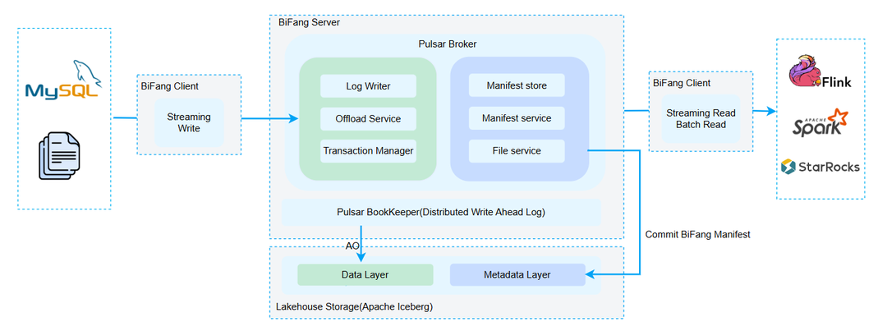
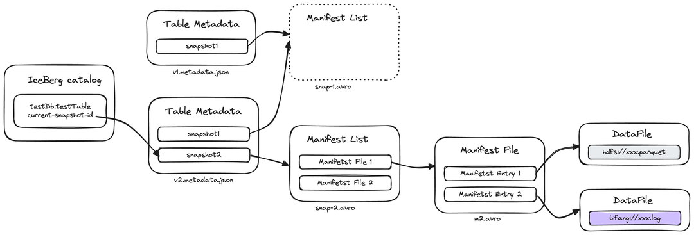
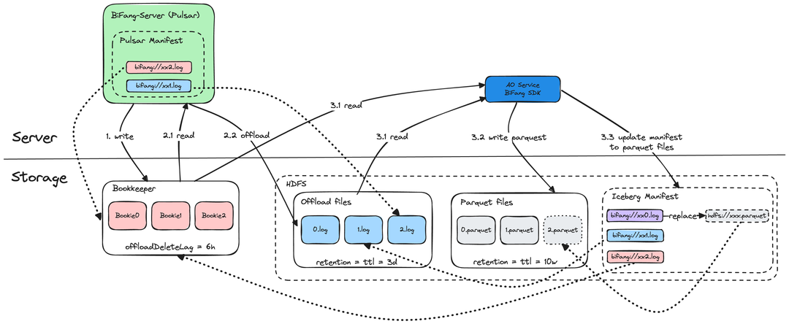
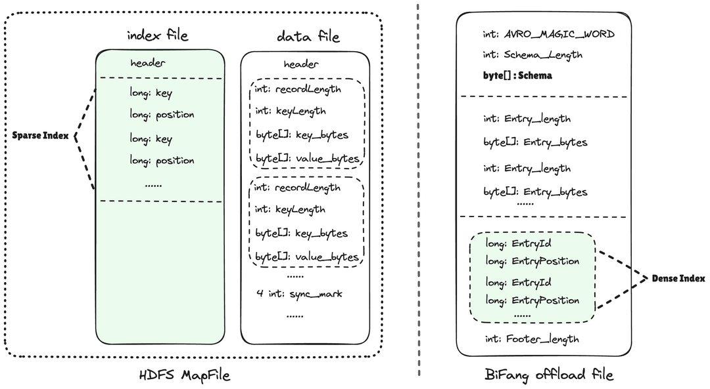
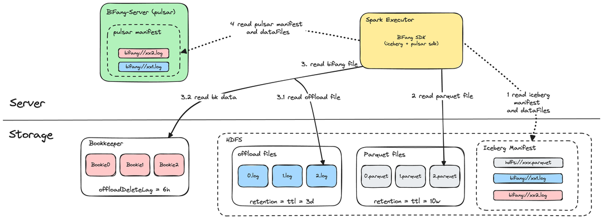

# BiFang 湖流一体数据实时读取原理和优化

> BiFang 是天穹大数据自主研发的湖流一体存储引擎，通过创新性地融合 Pulsar 流处理与 Iceberg 数据湖能力，实现流批数据处理入口统一，全面支持全增量数据查询、端到端数据实时可见等。BiFang 兼容主流的批流计算引擎，满足业务对数据实时性、一致性和灵活性的多样化需求。本文是 BiFang 技术系列文章之一，主要对数据存储以及读取做进一步的解析。

BiFang，中文为毕方，中国古神话中的神鸟，象征着变革和能量，隐喻湖流一体存储引擎的先进和可靠。

## 目录

- [1. 背景](#1-背景)
- [2. 元数据](#2-元数据)
- [3. 数据存储](#3-数据存储)
  - [3.1 数据流向](#31-数据流向)
  - [3.2 Offload 优化](#32-offload-优化)
  - [3.3 生命周期](#33-生命周期)
- [4. 数据读取](#4-数据读取)
  - [4.1 整体流程](#41-整体流程)
  - [4.2 性能优化](#42-性能优化)
- [5. 总结](#5-总结)

## 1. 背景

《天穹大数据——BiFang 湖流一体技术原理和实践》介绍了 BiFang 组件的使用场景、优势，以及整体的架构。相比于业界湖流一体技术方案都是数据分钟或者秒级可见，BiFang 最明显的优势是数据实时可见：BiFang 通过实时融合 Pulsar Manifest + Iceberg Manifest，用户可以实时查询 Iceberg 中的数据，将数据可见性从分钟级提高到亚秒级别，实现业务数据无延迟交付。

本文主要从数据读取阶段，详细介绍 BiFang 实时读取背后的技术细节。



## 2. 元数据

BiFang 统一使用 Iceberg 来表示湖流一体表，从用户视角只感知一种表，无需维护多套元数据系统。Table 相关的元数据统一放在 Iceberg 元数据，表相关操作不经过 BiFang，BiFang 根据 Hive Catalog 或者统一 Catalog 访问，Spec/Schema Change 和 Iceberg 处理方式一致。

得益于统一元数据，用户视角数据以流式行格式写入 BiFang Server 并实时提交到 Iceberg，全量数据则以 Iceberg 目录结构组织，读取以标准 Iceberg 协议来读取。下图为 BiFang 数据以 Iceberg 目录进行组织：



Iceberg 数据写入流程可抽象为创建文件并持续写入数据，在满足一定大小或 Checkpoint 时关闭文件并记录，Checkpoint 时提交记录的所有文件（上图 HDFS 前缀文件）。受限于 Checkpoint 周期，数据通常分钟可见。

BiFang 遵循 Iceberg 写入流程，不同之处在于 BiFang 提交到 Iceberg 的 dataFile（如上图带有 `bifang` 前缀的文件）并不是数据文件，而是 BiFang 的**逻辑文件**。逻辑文件只包含元数据信息，不存储真实数据，可使用 BiFang SDK 读取真实数据。逻辑文件信息基本都包含在文件路径中，精简格式如下：

```text
# 逻辑文件 file path
bifang://{db}/{table}/{ledgerId}_{rangeSet}.log

# Demo 示例
bifang://testdb/testTable/0_1-5_20-24.log
```

示例中 `1-5_20-24` 为逻辑文件包含的 Pulsar Entry 集合，标识真实包含 entryId 为 `{1,2,3,4,5,20,21,22,23,24}`。

## 3. 数据存储



上图为 BiFang 的存储架构，采用行列混合存储，数据分层存储于 Pulsar BookKeeper 和 Iceberg HDFS。元数据目录则由两部分组成，包括已提交到 Iceberg 的 Manifest、在 BiFang Server 内存中未提交 Manifest。结合存储架构图，接下来详细介绍下 BiFang 数据流向、Offload 优化和数据生命周期。

### 3.1 数据流向

BiFang 中同时存在 3 种格式物理文件，包括实时数据、Offload 文件和 AO 合并后的 Parquet 文件，分别存储在 BookKeeper 和 HDFS 中。Manifest 中真实数据指向物理 Parquet 文件，Manifest 中的 BiFang 逻辑文件指向 HDFS 中 Offload 文件或 BookKeeper Bookie 节点。逻辑文件并没有与之对应的物理文件，只是 HDFS 中 Offload 文件或者 BookKeeper 中包含逻辑文件所需的真实数据。数据流向如下：

- SDK 以流式数据写入到 BiFang Server，BiFang Server 同步方式写入到 BookKeeper 中（行存）；
- BookKeeper Ledger 关闭时触发 Offload，BiFang Server 异步将 BookKeeper 数据存储到 HDFS 存储中（行存）；
- AO（Auto Optimizer）服务定期将 Manifest File 中的 BiFang 逻辑文件进行合并，通过 File Service 提供的接口，读取到 BiFang 逻辑文件对应的实际数据，转换为 Parquet 数据文件并更新 Iceberg Manifest（列存）。

### 3.2 Offload 优化

Pulsar 原生支持数据分层存储，使用 Offload 功能将较旧的数据从 BookKeeper 转移到长期且更便宜的存储空间，消费时对用户透明，服务端根据配置和保存周期自动选择从 BookKeeper 或者分层存储读取数据。

在 BiFang 中 Offload 不是必须的，这部分数据可以只保留在 BookKeeper 中，AO Service 或者业务通过逻辑文件查询时，可直接查询 BookKeeper 中的数据。但是考虑到 BiFang Server 可能会因为大量的读请求影响稳定性，还是选择 Offload 数据到 HDFS 中。

BiFang Offload Service 基于 Pulsar 原生的 HDFS Offload 机制进行了定制化优化。原生方案采用 HDFS 的 MapFile 格式存储数据，该格式由数据文件（`/data`）和索引文件（`/index`）组成。索引文件中存储的是 Key-Value 对的稀疏索引，查询时首先通过内存中的索引定位到大致位置，随后在数据文件中进行小范围扫描（此过程可能产生部分读放大）。

在 Pulsar 的典型消费场景中，数据访问以顺序读取为主，只需要重置到某个点位然后往后消费，查找 `Entry --> Position` 次数较少，因此稀疏索引的查找效率对系统性能的影响较为有限。而 BiFang 一个逻辑文件包含同一个 Ledger 里的不同点位的数据，读取过程中需要不断地通过 EntryId 来读取数据，使用 MapFile 效率较低。所以 BiFang 重新设计了 Offload 的文件格式，文件格式如下图所示：



主要区别在于数据和索引信息保存在同一文件中，全量索引信息放在文件末尾，包含了全部的 `EntryId -> Position` 的映射关系，可快速查询指定 EntryId 的数据。同时 Offload file 中保存了完整的 Schema 信息，因为后续 BiFang SDK 读取 Offload file 时不经过 BiFang Server，从而没有办法获取 Pulsar 原始的 Schema 信息。

### 3.3 生命周期

BookKeeper 和 Offload 数据生命周期由 Pulsar Retention 和 TTL 参数来控制，Parquet 文件由 AO 来管理生命周期。通常 BookKeeper 只存储小时级别数据，Offload 文件保存几天，而 Parquet 文件用户可配置长期存储。合理的配置可以让 BiFang 只存储一份全量数据：AO 合并成 Parquet 文件后 Offload 文件可以删除，已 Offload 的数据也可以在 BookKeeper 中删除。

存储架构图中，BiFang 只有少量实时数据在 BookKeeper，大部分的数据都存储在低成本的 HDFS 中。不仅消除了 Pulsar 存储周期限制，同时绝大部分读操作都可由吞吐更高的 HDFS 集群承担，只有查询最新数据时流量才会穿透 BiFang Server，可以支持高并发读取历史数据。同时读写分离架构，可针对读/写不同特点分别优化硬件配置以实现成本最优。

## 4. 数据读取

上文提到，BiFang Manifest 由 Iceberg Manifest 和 Pulsar Manifest 两部分组成，BiFang 数据（dataFile）包含实时数据、Offload 文件以及经过 AO 优化的 Parquet 文件。数据读取过程需要动态关联 Manifest 与不同阶段的 BiFang 数据，接下来将详细介绍 BiFang 读取数据整个过程。

### 4.1 整体流程

数据读取包括 Iceberg Manifest 和 Pulsar Manifest 和对应的数据文件，本节以 Spark SQL 执行 `select * from testdb.testTable` 进行全表扫描为例详细说明，整体流程如下：



**（1）已提交 Iceberg Manifest 及文件读取**

- 步骤 1：读取 Manifest 并过滤出 dataFiles，然后根据 dataFile 类型构建对应 InputFile；
- 步骤 2：读取 Parquet 文件，这里沿用 Iceberg `HadoopInputFile` 读取逻辑；
- 步骤 3：读取逻辑文件，前置判断访问 BiFang Server 查询 Ledger 是否 Offload：
  - 3.1：已 Offload 逻辑文件，创建 `BiFangHadoopInputFile` 从 HDFS 中进行读取。其中 `BiFangHadoopInputFile` 为 BiFang 定制化读取 Offload 文件工具，下文将会展开讲解；
  - 3.2：未 Offload 逻辑文件，创建 `BiFangInputFile` 对象从 BookKeeper 中进行读取。其中 `BiFangInputFile` 为 BiFang 定制化读取实时数据工具，下文将会展开讲解。

**（2）未提交 Pulsar Manifest 及文件读取**

- 步骤 4：BiFang Server 提供查询接口供 Iceberg 查询实时 Pulsar Manifest，获取 Pulsar Manifest 并过滤出 dataFiles。

#### 4.1.1 BiFangHadoopInputFile 类读取 HDFS 文件

`BiFangHadoopInputFile` 实现 `org.apache.iceberg.io.InputFile` 接口，用来从 HDFS Offload 文件中读取逻辑文件数据。Offload 文件内部包含了 entryId 索引信息（格式详解见 3.2）。通过索引文件可以高效读取数据，读取流程关键代码如下：

```java
void read(String filePath, List<Range> rangeSet) {
  fs = FileSystem.open(filePath);  // 打开 hdfs 文件
  schema = readSchema(fs);         // 读取 schema 信息

  // 跳到文件末尾读取索引信息
  fs.seek(length - FOOT_BYTES_LENGTH);
  int footLen = fs.readInt();
  byte[] footBytes = new byte[footLen];
  fs.seek(length - FOOT_BYTES_LENGTH - footLen);
  fs.readFully(footBytes);
  indexs = decode(footBytes);      // 解析索引到内存

  // read entries
  for (Range range : rangeSet) {
    long start = range.getStart();
    long end = range.getEnd();
    // seek 到 range 起始位置，然后持续读完该 range
    fs.seek(indexs(start));
    for (int i = 0; i < (end - start) + 1; i++) {
      byte[] entry = new byte[fs.readInt()];
      fs.readFully(entry);
      process(entry);
    }
  }
}
```

#### 4.1.2 BiFangInputFile 类读取 BookKeeper 文件

如果 BookKeeper 中的数据还没有 Offload 完成，就需要使用 `BiFangInputFile` 从 BiFang Server 读取。`BiFangInputFile` 同样实现了 `org.apache.iceberg.io.InputFile` 接口。

由于 BiFang Server 只支持 MQ 语义，消费时只能 seek 到某个点位，然后从这个点位往后消费，并不适用于 BiFang 逻辑文件的 RangeSet 跳跃读取。所以基于 Pulsar Reader，设计了一套新的消费 `RangeReader` API 来提供点查和范围查询功能，用户可以批量指定某个点位或者范围来获取数据。`BiFangInputFile` 内部使用这套 API 从 BiFang Server 中读取逻辑文件包含的 RangeSet，关键代码片段如下：

```java
RangeReader<byte[]> rangeReader = pulsarClient.newRangeReader()
    .topic(topic)
    .positions(ledgerId, ranges)  // 直接指定 ledger 和 RangeSet
    .create();

while (!rangeReader.hasReadAllMessages()) {
  // 读取接口类似于 Reader，不断读取数据，直到指定的 RangeSet 都读完
  Message<byte[]> message = rangeReader.read();
}
rangeReader.close();
```

`RangeReader` 底层实现复用 PulsarReader 客户端原有逻辑，消息推送模式、流控、线程模型等都保持现状，不需要做 offset 管理，服务端按照指定的 RangeSet 来推送消息。`RangeReader` 内部同时维护消息的接收情况，全部消息都接收完成后关闭。

`RangeReader` 经过性能压测，消费延迟和吞吐基本和原生 Reader 持平。主要原因在于 BookKeeper 本质上就是 KV 存储，内部使用 RocksDB 存储 `(ledgerId, entry) --> Position` 索引信息，天然支持点查。相比之下，Kafka 等大多数 MQ 内部使用稀疏索引来存储点位信息，直接点查效率可能达不到预期。

### 4.2 性能优化

实时数据过 BiFang Server 读取，最终会在 BookKeeper 中查询数据返回。BiFang 对消息读取的时延和吞吐做了多项优化，下面介绍较为显著的两种。

#### 4.2.1 BatchRead 批量读取

目前 Pulsar 读取 BookKeeper 数据为每个 EntryId 发送一个请求包，会导致 QPS 过多，带来更多的内存和 CPU 压力，从而降低读取吞吐。

BatchRead 模式一个请求中只需要携带起始的 EntryId 和条数、大小等信息，Bookie 会直接在一个响应中返回多条消息，降低了大量小包给服务的性能损耗。由于 BatchRead 需要 Bookie 一次性返回多条消息，就要求 Ledger 关联的 Ensemble Bookie 有全量数据，所以 BatchRead 模式需要**禁止条带化写入**。条带化写入为 Pulsar 写 BookKeeper 的常用方式，如果配置 `E > Qw`，数据会条带化均匀写入到 Bookie 节点，比如：

```text
# 假设当前 Topic 配置：
E=3, Qw=Qa=2, ensemble=bookie0,bookie1,bookie2;

# 写入 0/1/2 消息，分布为:
消息 0=[bookie0,bookie1]; 消息 1=[bookie1,bookie2]; 消息 2=[bookie2,bookie0]
```

由于 bookie0 只有消息 0 和消息 2，`BatchRead(0-2)` 将无法完成。BiFang Server 强制设置 `E=Qw=Qa`，使得 Ensemble Bookie 节点拥有全量数据，从而可以支持 BatchRead 特性。同时非条带化写入也可优化 Bookie 服务端预读效果。

Bookie 为了避免生成过多小文件，多个 Ledger 数据会攒批以 Ledger 维度排序后写入同一个文件，所以在物理文件中单个 Ledger 的数据是局部有序且连续的。利用这个特性，BookKeeper 在读取 Ledger 数据时，会把物理文件中属于该 Ledger 且连续的 Entry 预读到内存中以减少随机 IO。非条带化写入的 Ledger 读写收敛于更少量的 Bookie，物理文件中 Ledger 连续的数据会更多，预读效果会更好，同时预读缓存的命中率也会提升。

通过非条带化写入且使用 BatchRead 模式，降低了 QPS 并提升预读效果，相对于单条读整体时延明显降低。Entry 越小优化效果越好，经过测试，在生产环境多 Topic 同时写场景，消息读取耗时可以降低 20% ~ 40%。

#### 4.2.2 支持 RawReader

`RangeReader` API 基于 Pulsar Consumer 封装。Consumer 基于 MQ 语义，客户端需要维护提交点位，需要为 Batch 内的每条消息都构建 MessageId 并跟踪提交情况。

而 BiFang 逻辑文件只需读到数据，不需要做提交位点的维护和过滤操作。所以 `RangeReader` 参考了 Pulsar Broker 中 Compaction RawReader 读取行为，精简掉多余逻辑，只保留了流控以及数据解析逻辑。

优化效果与 Batch 内消息数（BatchSize）成正比，测试数据如下，控制其他变量不变（单消息 100 字节，总消息数 1000w），下表为 BatchSize 与总读取耗时关系：

| BatchSize（条） | 1 | 10 | 50 | 100 | 200 |
| --- | --- | --- | --- | --- | --- |
| Read 耗时（ms） | 366060 | 41309 | 13152 | 9545 | 8393 |
| RawRead 耗时（ms） | 357200 | 36001 | 10319 | 6374 | 4643 |
| 耗时优化 | 2.4% | 12.8% | 21.5% | 33.2% | 44.6% |

## 5. 总结

BiFang 统一了数据元数据，通过服务端实时融合 Pulsar Manifest + Iceberg Manifest，客户端使用 BiFang SDK 实时查询 Iceberg 全增量数据的方式，实现了数据端到端实时可见，满足业务对数据实时性、一致性和灵活性的多样化需求。BiFang 已经具备生产条件，除了上文提到的数据存储、读取优化，BiFang 还构建了完备的监控告警、端到端对账等配套能力，后续也将公布更多技术实现细节。