# Apache BookKeeper 一致性协议解析

> Apache Pulsar 是一个多租户、高性能的服务间消息传输解决方案，支持多租户、低延时、读写分离、跨地域复制（GEO replication）、快速扩容、灵活容错等特性。Pulsar 存储层依托于 BookKeeper 组件，所以本文简单探讨一下 BookKeeper（下文简称 BK）的一致性协议是如何实现的。

## 目录

- [1. 背景](#1-背景)
- [2. 一致性协议简介](#2-一致性协议简介)
- [3. BookKeeper 基本能力](#3-bookkeeper-基本能力)
- [4. 创建 Ledger](#4-创建-ledger)
- [5. 数据写入](#5-数据写入)
  - [5.1 正常返回](#51-正常返回)
  - [5.2 LAC（LastAddConfirmed）](#52-laclastaddconfirmed)
- [6. 故障处理](#6-故障处理)
  - [6.1 写入失败](#61-写入失败)
  - [6.2 ensembleChange](#62-ensemblechange)
  - [6.3 客户端故障](#63-客户端故障)
  - [6.4 fence Bookie](#64-fence-bookie)
  - [6.5 恢复 LAC](#65-恢复-lac)
- [7. 消费](#7-消费)
- [8. 总结](#8-总结)

## 1. 背景

在之前的文章中提到，Pulsar 相对于 Kafka 根本的区别在于数据一致性协议，这也是为什么 Pulsar 可以做到两副本就能保障高可用、高可靠，在磁盘使用方面更均衡，也不会存在单分区容量上限。同时在扩缩容、故障屏蔽等日常运维方面更加灵活和方便。

## 2. 一致性协议简介

我们常见的一致性协议，比如 Raft、Kafka、ZAB 等，都是服务端集成协议（协议控制和数据存储绑定），简单来说一致性协议由服务端存储节点来执行。数据流向通常是客户端写数据到 Leader 节点，其他节点再通过推或拉的方式从 Leader 获取数据。

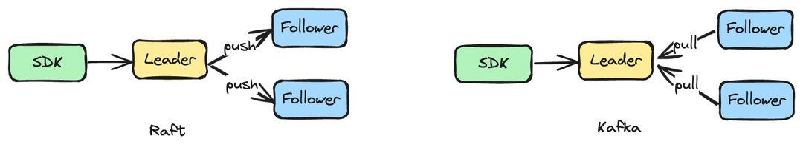

而 BK 的一致性协议很有意思，协议控制和存储是分开的，协议控制是在客户端执行，可以称之为外部一致性协议，或者客户端一致性协议。数据流向为客户端向多台存储节点同时写入数据，存储节点之间基本不通信。

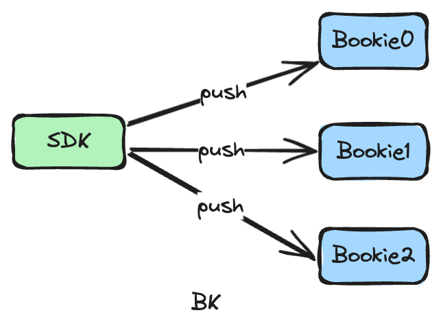

由于一致性协议主要是在客户端执行，本文聚焦于 BK 客户端的实现。

所以，外部一致性协议需要解决的问题就简化成：给定 N 个 KV 存储（Bookie，高性能、低可靠）和一个分布式协调系统（下文以 ZK 为例，低性能、高可靠），如何实现高可用、高可靠、低时延的读写服务。这里引入 ZK 集群的原因是 Bookie 节点会动态增减，需要有注册中心能让客户端拉取存活 Bookie 的 IP:Port，同时客户端不具备存储能力，协议控制必要的元信息也需要存储到外部。

在详细了解 BK 一致性协议之前，我们先简单介绍一下 BK 提供的基础能力。

## 3. BookKeeper 基本能力

协议作者设计 BK 初衷是提供分布式日志段（Ledger）而不是无界日志（如 Raft、Kafka）。所以 BK 提供的主要能力就是创建、删除 Ledger 以及 Ledger 的读写操作。代码片段如下：

```java
public interface BookKeeper extends AutoCloseable {
  CreateBuilder newCreateLedgerOp();   // 创建新 Ledger
  OpenBuilder newOpenLedgerOp();       // 打开已存在 Ledger
  DeleteBuilder newDeleteLedgerOp();   // 删除 Ledger
}

public interface ReadHandle extends Handle {
  // 从 ledger 里读数据
  CompletableFuture<LedgerEntries> readAsync(long firstEntry, long lastEntry);
}

public interface WriteHandle extends ReadHandle, ForceableHandle {
  // 往 ledger 写数据
  CompletableFuture<Long> appendAsync(ByteBuf data);
}
```

而 MQ 场景需要提供无界数据流，所以 Pulsar 为每一个分区维护一组 Ledger，每个 Ledger 只会写一定量数据（条数 / 大小 / 时间限制），写满就会创建新的 Ledger 来继续写入，只有最新的 Ledger 可以写入，历史的 Ledger 只能读取。再根据用户配置的数据保存策略逐步删除历史 Ledger。

Pulsar 内分区 Ledger 组成如下：

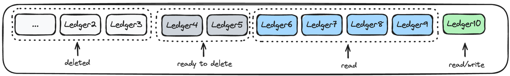

Pulsar 内分区的元数据如下：

```json
{
  "lastLedgerCreatedTimestamp": "2024-06-06T17:03:54.666+08:00",
  "waitingCursorsCount": 0,
  "pendingAddEntriesCount": 2,
  "lastConfirmedEntry": "11946613:185308",
  "state": "LedgerOpened",
  "ledgers": [
    {
      "ledgerId": 11945498,
      "entries": 194480,
      "size": 420564873,
      "offloaded": false,
      "underReplicated": false
    },
    {
      "ledgerId": 11946057,
      "entries": 194817,
      "size": 420583702,
      "offloaded": false,
      "underReplicated": false
    },
    {
      "ledgerId": 11946613,
      "entries": 0,
      "size": 0,
      "offloaded": false,
      "underReplicated": false
    }
  ]
}
```

> 最后一个 Ledger 未关闭，所以 `entries` 和 `size` 都还是 0。

## 4. 创建 Ledger

BK 以 Ledger 维度对外提供服务，第一步就是创建 Ledger。一致性协议高可用是由数据的多副本存储来实现的，所以创建 Ledger 时需要明确指定该 Ledger 的数据存储在几台 Bookie（E），每条数据写几份（Qw），需要等到多少台 Bookie 确认收到数据后才认为数据写入成功（Qa）。代码片段如下：

```java
public interface CreateBuilder extends OpBuilder<WriteHandle> {
  // E: 接收该 Ledger 数据的节点数，默认值 3
  CreateBuilder withEnsembleSize(int ensembleSize);

  /**
   * Qw: 每条数据需要写几个节点，默认值 2
   * 如果 E > Qw，数据会条带化均匀写入到 Bookie 节点，按照默认配置，
   * 写入顺序为: 消息0=0,1; 消息1=1,2; 消息2=2,0
   */
  CreateBuilder withWriteQuorumSize(int writeQuorumSize);

  // Qa: 需要等待几台节点确认写入成功，默认值 2
  CreateBuilder withAckQuorumSize(int ackQuorumSize);
}
```

配置条带化写入（E > Qw）可以让多个节点分摊该 Ledger 的读写压力，但是由于数据会更分散且不连续，会影响服务端读写优化（顺序写、预读、批读等），所以生产环境建议配置 E=Qw。而 Qa < Qw 可以让客户端避免等待慢节点返回从而降低写入时延，但是优化效果有限，同时增加了存储成本，可以配合客户端熔断以及服务端指标来剔除慢节点。简单来说，**建议生产环境配置 E=Qw=Qa**。

在创建 Ledger 时，客户端会从 ZK 中拉取全部 Bookie，根据 `EnsemblePlacementPolicy` 放置策略挑选节点，默认策略会随机挑选出 E 个数的节点作为初始存储节点以保证存储节点使用均衡。同时 BK 提供丰富的放置策略满足用户实现跨机房、地区容灾的需求。

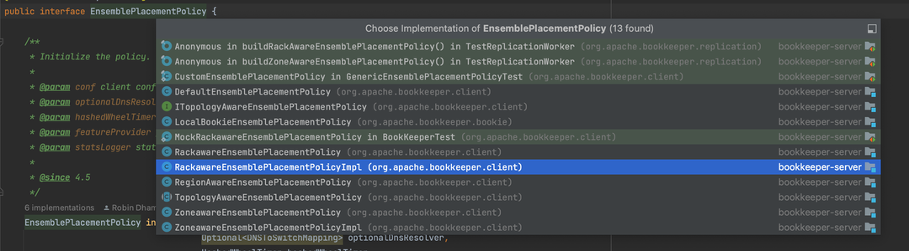

现在我们已经有了 Ledger 基本元数据，包含 Ledger 配置信息以及初始的 Bookie 列表。由于 Ledger 需要全局唯一，所以还需要使用 ZK 获取一个全局唯一的 ID，最后把全部元数据写入到 ZK 集群即可（创建过程无需与 Bookie 节点交互）。代码如下：

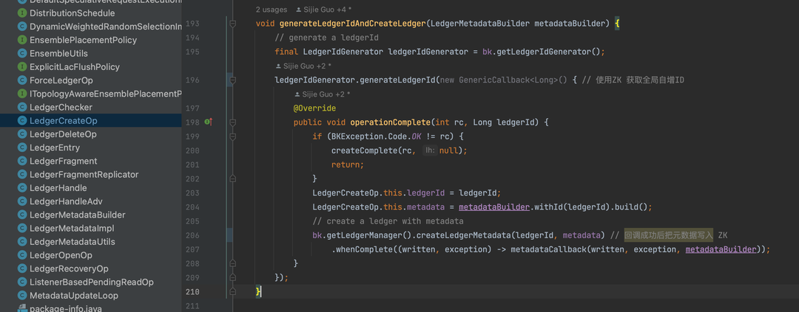

BK 中 Ledger 元数据信息如下：

```text
LedgerMetadata {
  formatVersion = 3, ensembleSize = 3, writeQuorumSize = 3, ackQuorumSize = 3,
  state = CLOSED, length = 461178392, lastEntryId = 203045,
  digestType = CRC32C, password = base64:,
  ensembles = {
    0 = [127.0.0.1:3181, 127.0.0.2:3181, 127.0.0.3:3181]
  },
  customMetadata = {
    component = base64:bWFuYWdlZC1sZWRnZXI=,
    pulsar/managed-ledger = base64:cHVibGljL2RlZmF1bHQvcGVyc2lzdGVudC9kd2RfMjEwODQtcGFydGl0aW9uLTA=,
    application = base64:cHVsc2Fy
  }
}
```

## 5. 数据写入

Ledger 已经创建好了，现在可以往里面写数据了。由于 Bookie 是个 KV 存储，数据需要全局唯一的 Key。Ledger Id 已经是全局唯一了，并且只有创建这个 Ledger 的客户端才能往里面写数据，所以数据的 key 为 `LedgerId + EntryId`（客户端单调自增即可）。

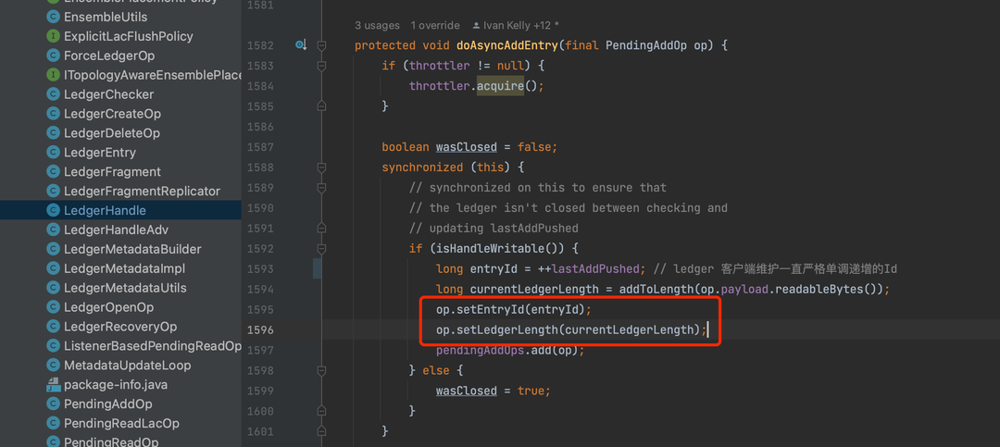

每次写入都从 E 个 Bookie 中顺序挑选出 Qw 个节点（writeSet）并行发送数据。

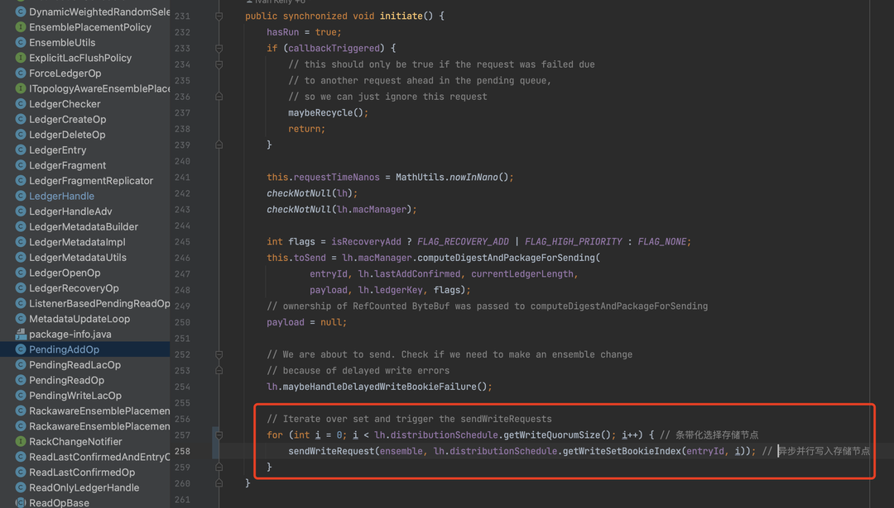

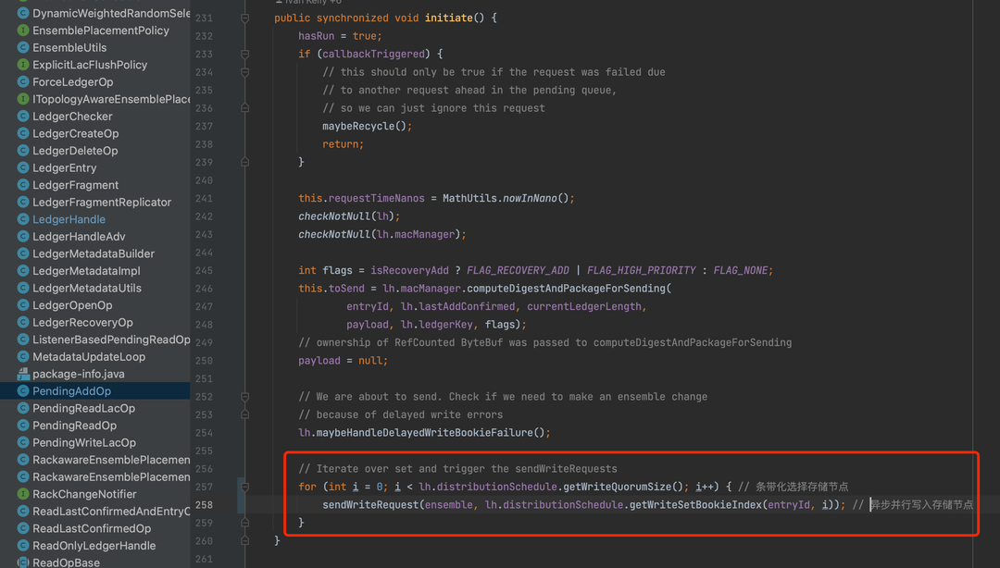

可以看到客户端并行写入 Bookie 节点，Bookie 间也不需要做数据同步，所以 Pulsar 即使加了一层 Broker 层，但是写入时延还是能做到和 Kafka 基本一致（2RTT）。

### 5.1 正常返回

发送数据后，如果收到 Qa 个数成功响应，就可以认为这条数据写入成功了。同时这条数据也可以被读取。

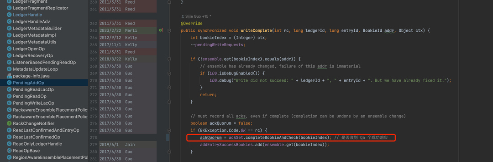

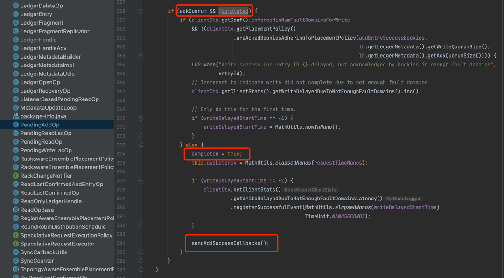

### 5.2 LAC（LastAddConfirmed）

由于 entryId 单调递增，数据按顺序写入，当一个位置的数据成功写入到 Qa 个存储节点后，就意味着该条数据以及之前的所有数据都可以被消费走，这个位置就是可读位置（不考虑事务）。由于已写入多副本，也意味着这些数据可以在部分存储节点故障下存活，从而保证读一致性。不同协议中有不同的叫法：在 BK 中，这个位置称为 LAC（LastAddConfirmed），Kafka 中称为 HW（High Watermark），在 Raft 中称为 commitIndex。

下面代码可以看到，成功写入一条数据后会立即更新可读位置。

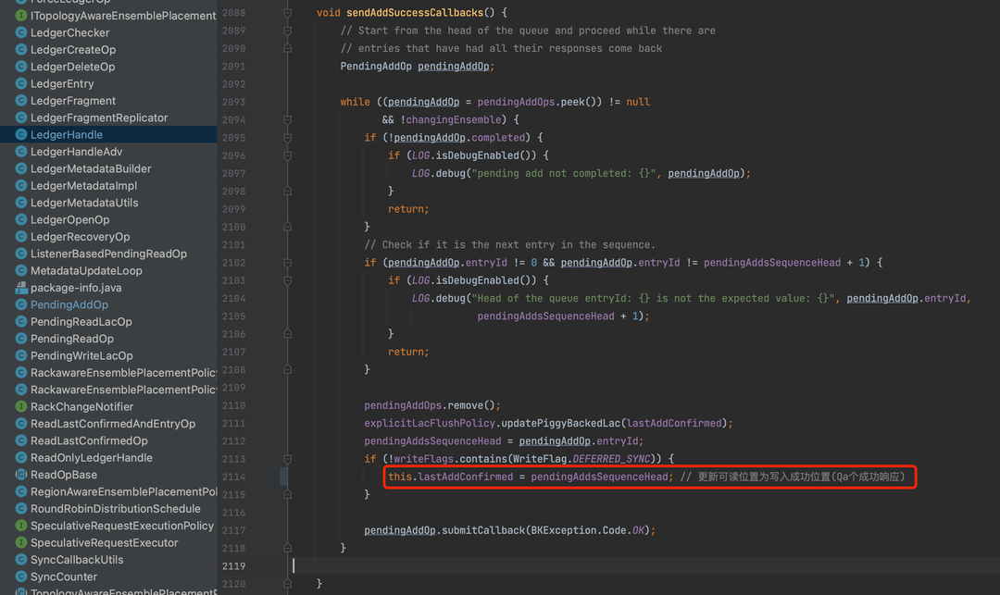

LAC 是一致性协议至关重要的信息。正常情况下，LAC 只需要维护在内存中，写入成功后更新，读取时使用 LAC 来限制读取位置即可。如果当前 Ledger 写满了，正常关闭，需要把 LAC 也保存在 ZK 的元数据中，这样重新打开 Ledger 用于读取时，才能加载 LAC 回内存中，用来正确限制读取位置，同时 LAC 值也能标识 Ledger 中存储的数据条数。

而异常情况下，故障会直接导致内存中的 LAC 丢失，这是不可接受的。最简单粗暴的方式是每次更新 LAC 都直接同步到 ZK 中，但显然 ZK 性能无法满足高频率写入，所以 BK 的做法是在每条数据都携带 LAC 信息一起写入到 Bookie 中。

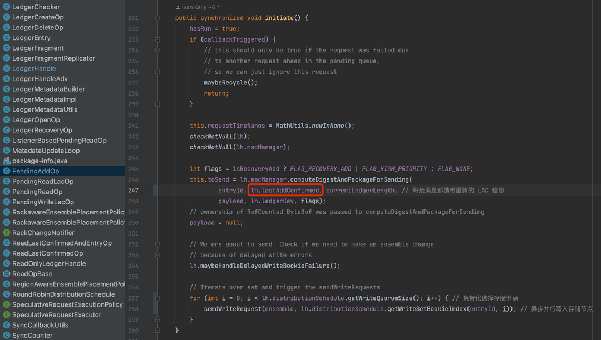

如下图，由于最新的 LAC 需要等下一轮的消息写入才会一起存储到 Bookie，所以 Bookie 中存储的 LAC 与实际的 LAC 相比是存在一定滞后。

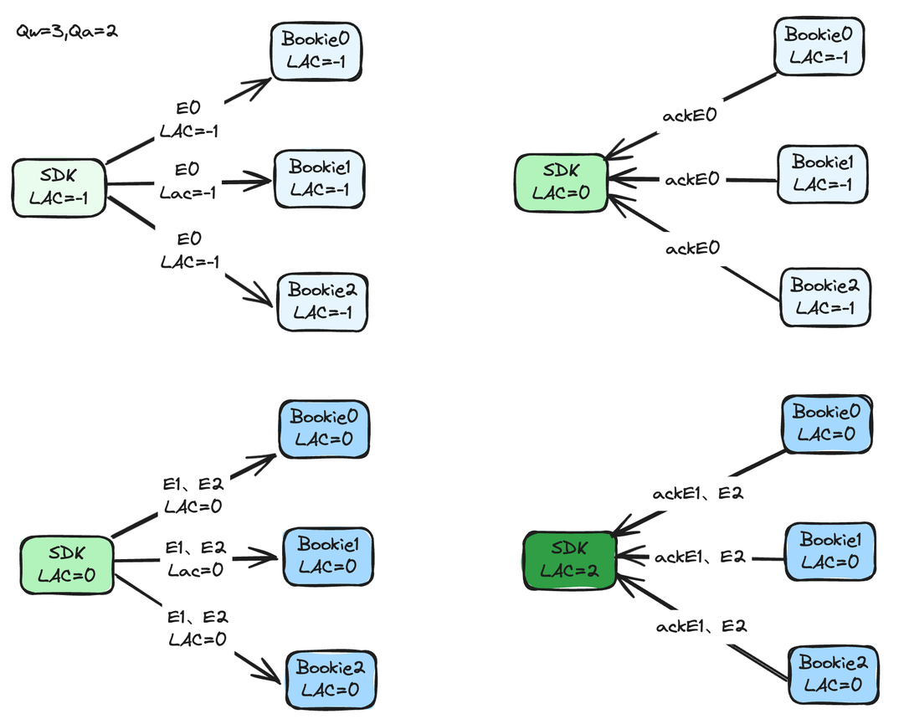

上图可看到初始时客户端和 Bookie 中的 LAC 都为 -1，在一轮写入后，Bookie 中的 LAC 就会滞后于客户端了。好在这个问题并不会影响到一致性协议的正确性，下文中会提到。

## 6. 故障处理

因为需要容忍一定数量的节点故障，所以一致性协议复杂的部分都在故障处理逻辑。接下来我们先看写入失败场景。

### 6.1 写入失败

Kafka、Raft 等集成一致性协议，部分存储节点异常处理相对简单：如果是 Leader 节点故障，切换到其他节点进行读写即可；如果是 Follower 节点异常，通常不需要做任何操作，只需要等节点恢复后，从 Leader 节点同步数据补齐差异。由于节点是带存储的，所以可以容忍较长时间的节点故障。

而 BK 是在客户端实现的一致性协议，客户端不带存储，没写成功的数据需要缓存在内存里，显然可缓存的数据是非常有限的，同时没有写成功 LAC 是不能推进的，整个写入也就停止了。所以 BK 在写入失败时，最好的方式就是挑选新的 Bookie 节点重新写入。创建 Ledger 时已经指定了初始的 Bookie 列表，后续的 Bookie 列表变更都称为 ensembleChange。

### 6.2 ensembleChange

如下图所示，写入失败时会替换新节点重新写入，同时也会把新元数据更新到 ZK。每次 ensembleChange，ensembles 中就会新增一个 fragment，起始位置为当前 LAC + 1。

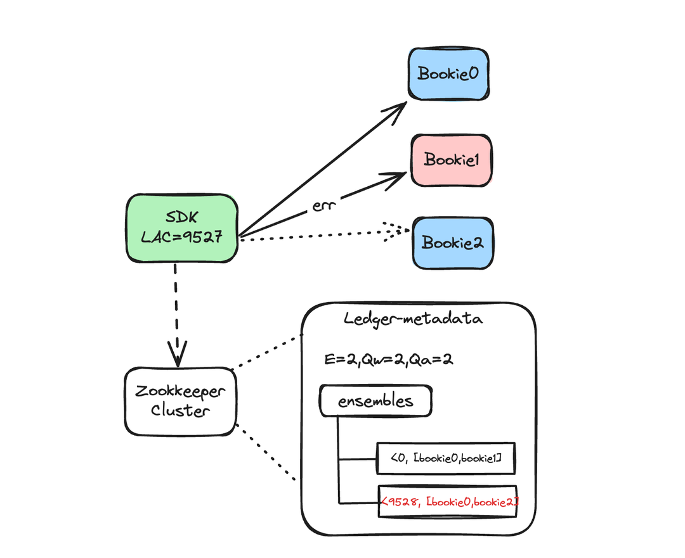

写入存储节点失败简单可以分两种情况：如果还没有收到 Qa 个数成功响应前，收到了错误响应（比如超时等），会立即执行 ensembleChange；如果已经收到了 Qa 个数成功响应（更新 LAC），后续的错误响应只会记录下失败 Bookie 节点，在下一次写入时再触发 ensembleChange。如果是不可恢复的异常，会直接返回写入失败，不会做 ensembleChange。

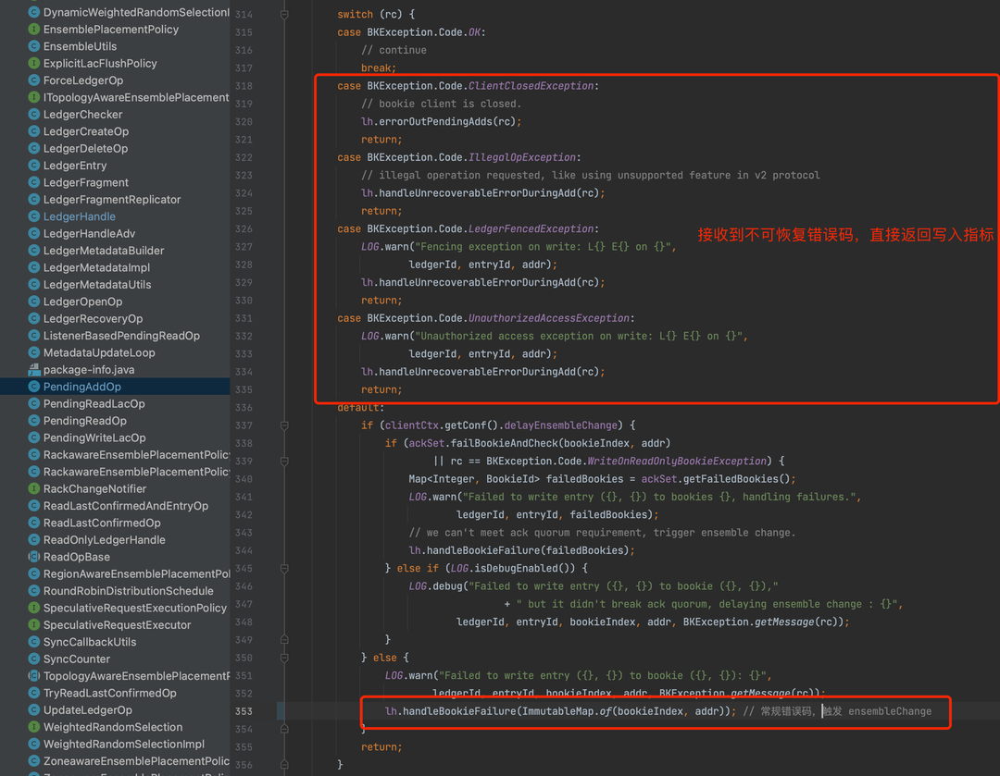

ensembleChange 和初始创建 Ledger 一样，需要先选择新的 Bookie 节点列表，替换掉失败的 Bookie 节点列表，然后把替换后的元数据更新回 ZK。代码如下：

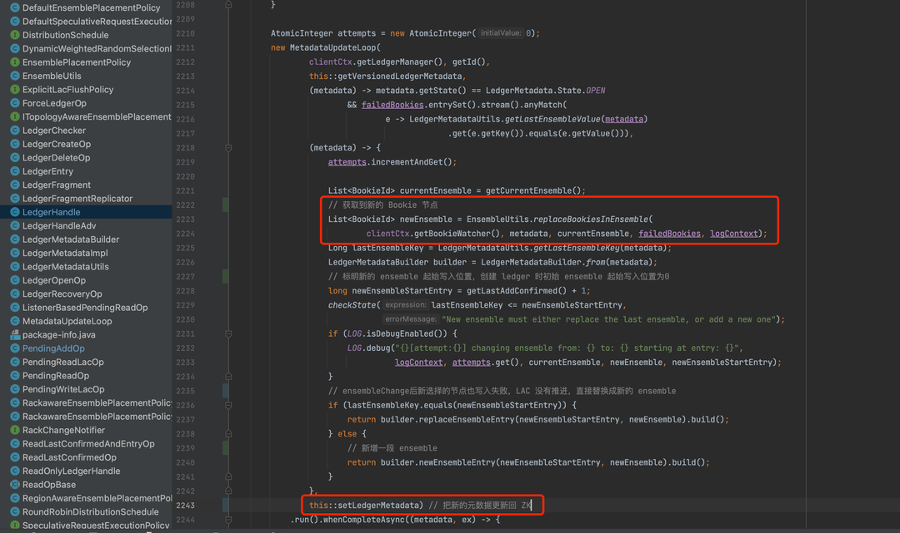

更新完元数据后，重写数据到新节点，或者根据条件重新触发 ensembleChange，代码如下：

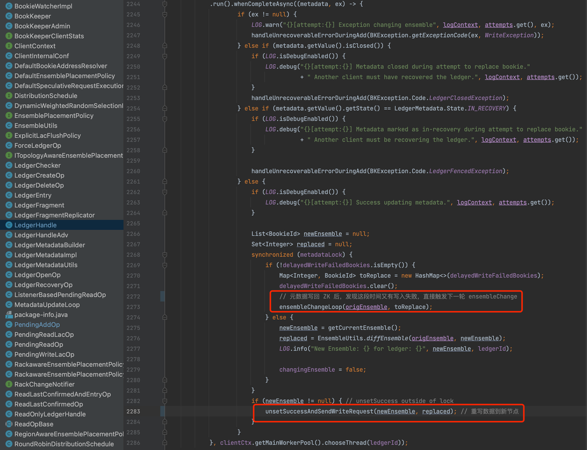

简而言之，在写入 Bookie 异常时，BK 客户端都会尝试切换 Bookie 节点重写数据。如果遇到无法恢复的状态码，就会直接往外层抛出异常。上层使用方比如 Pulsar 侧接收到这个异常后，会正常关闭当前 Ledger，然后创建新的 Ledger 继续写入。

### 6.3 客户端故障

如果存储 Bookie 节点故障，客户端可以切换其他 Bookie 继续完成写入。接下来我们看看如果正在写入的客户端故障了，应该怎么处理。

在 Pulsar 架构里，BK 客户端是 Pulsar Broker 内的一个组件，当 Pulsar Broker 故障后，分区的 Leader 会切换到新 Broker 继续服务。由于 BK 客户端故障时没有来得及正确关闭 Ledger，当前 Ledger 数据是不可读的，因为 LAC 信息已经丢失。所以新 Broker 主要任务就是要恢复 LAC 信息，然后正确关闭 Ledger，这样 Ledger 内数据就可以正确读取，最后再创建新的 Ledger 来恢复写入。由于恢复过程对应分区无法写入，所以要求恢复过程越快越好，不可存在长时间阻塞。

### 6.4 fence Bookie

在恢复之前，由于老 Broker 有可能是短暂假死（比如长时间 GC、网络隔离等），后续可能还会持续向当前 Ledger 写入数据导致脑裂。所以恢复的第一步就是要通知对应 Bookie 节点，后续禁止往这个 Ledger 里面写任何数据，这个过程称为 fence。过程相对简单，就是向所有 Ensemble 中的 Bookie 节点发送请求让其禁止该 Ledger 的后续写入。如下图所示：

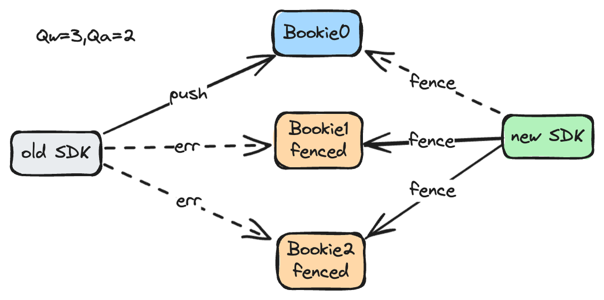

由于当前 Bookie 节点不能保证全部存活，同时需要满足快速恢复，所以需要考虑客户端至少收到多少个成功响应，才能认为 fence 操作执行成功。这里可以反过来想一下：客户端每次需要写入 Qw 个节点，然后收到 Qa 个成功响应就能认为写入成功，我们只需要让其凑不足 Qa 个成功响应就好了，也就是我们 fence 掉的节点数只要大于 Qw - Qa，那写入客户端就一定凑不足 Qa 个成功响应。我们暂且称这个数量为 Qf，例子如下：

```text
Qw = 5, Qa = 3 ==> Qf = 5 - 3 + 1 = 3
Qw = 3, Qa = 2 ==> Qf = 3 - 2 + 1 = 2
Qw = 3, Qa = 3 ==> Qf = 3 - 3 + 1 = 1  // Qw=Qa 场景需要 fence 的节点数最少，恢复最快
```

由于每次写入都要从 E 个 Bookie 中挑选出 Qw 个节点来条带化写入，所以还需要保证任意一组 Qw，我们都 fence 掉了对应的 Qf 个节点。例子如下：

```text
假设 E=3, Qw=Qa=2, Bookies 列表为 0,1,2, Qf=2-2+1=1
由于会条带化写入，每次写入挑选两台节点，全部组合为:
0,1  // 0,1 节点至少要成功 fence 掉一台
1,2  // 1,2 节点至少要成功 fence 掉一台
2,0  // 2,0 节点至少要成功 fence 掉一台
易得 0,1,2 三台节点至少要成功 fence 掉两台。

同理可证如果按上文中推荐配置 E=Qw=Qa，任何情况下都只需要 fence 掉任意 1 台节点即可，
fence 节点数量最少，恢复最快。
```

实际 BK 中实现的代码逻辑是统计任意 writeSet 未成功响应数大于等于 Qa 都认为未成功（功能一致），代码如下：

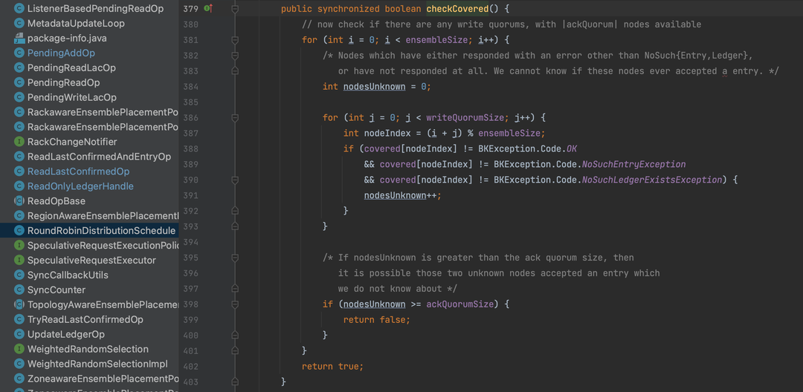

### 6.5 恢复 LAC

恢复主要的任务就是恢复 LAC 信息，上文中已经介绍 LAC 信息位于每条数据中存储在 Bookie 里面。接下来看看恢复整个过程。

#### 6.5.1 修改元数据状态

第一步：把 Ledger 状态改成 recovery 状态。

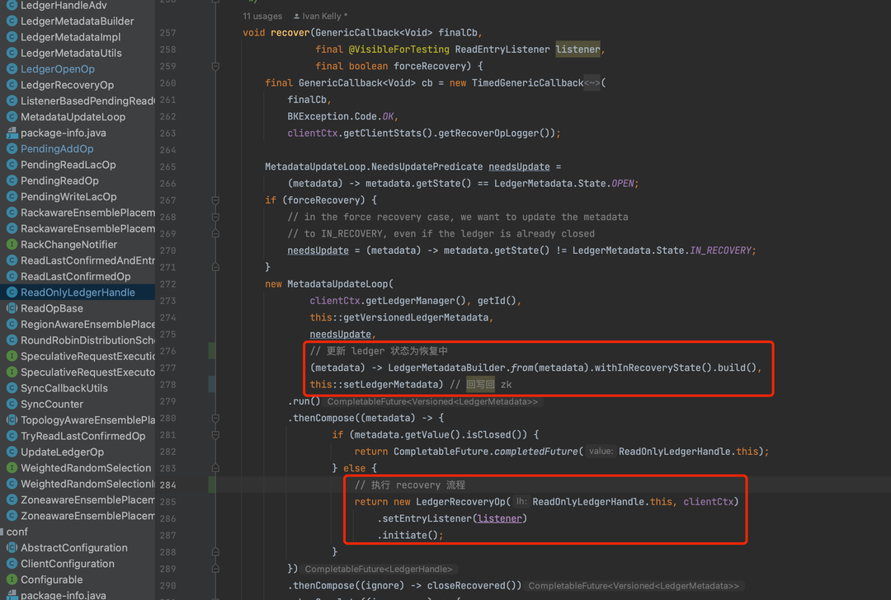

#### 6.5.2 读取初始 LAC

第二步：读取 Bookie 中的 LAC。下图代码中可以看到 fence Bookie 操作其实与查询最后 LAC 为同一个请求，只是携带了 fence 标识。

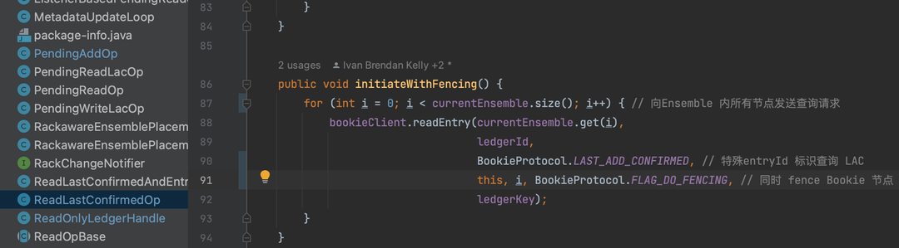

取最大的 Bookie LAC 值返回：

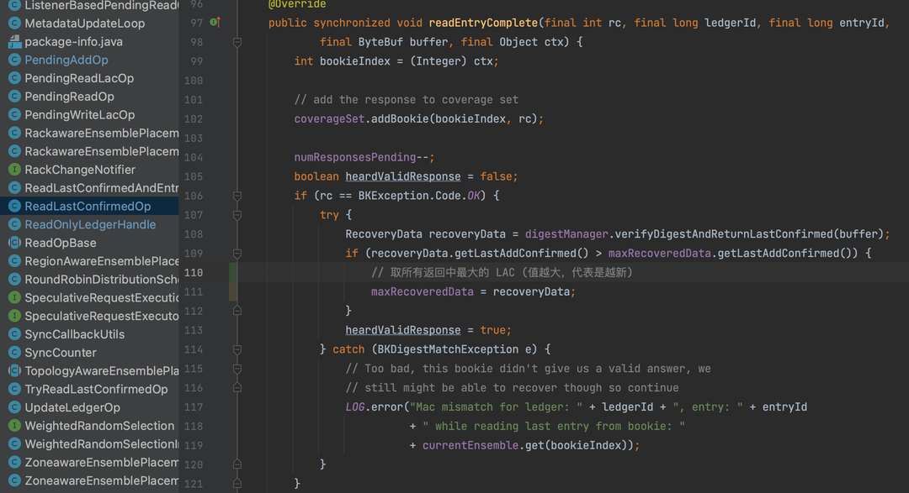

初始 LAC = `max(zkLac, bookieLac)` 作为初始 LAC：

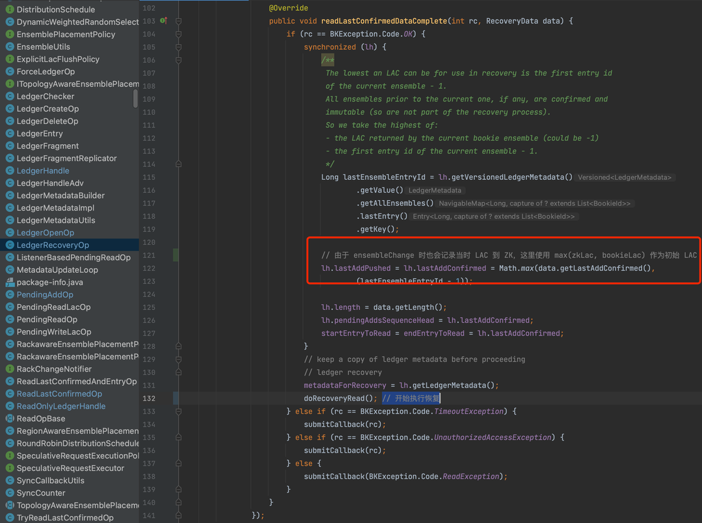

#### 6.5.3 恢复真实 LAC

由于 Bookie 中存储的 LAC 有滞后性，也就是真实 LAC（故障前内存中的 LAC）往往大于目前从 Bookie 查询到的 LAC 最大值。所以我们还需要恢复真实的 LAC。在找到真实的 LAC 之前，我们先确定一个基本的原则：

> 最终恢复的 LAC 可以大于真实 LAC，但是绝对不能小于真实 LAC（会导致数据丢失）。

比如一条数据已经成功写入到 Qa 个节点中，但是客户端还没来得及接收到 Qa 个成功响应（不更新 LAC）就故障了，那么恢复时把这条数据 entryId 更新到 LAC 也是合理的。换句话说，当数据成功写入到了 Qa 个节点中的那一刻，真实 LAC 就应该立即更新，只不过客户端内存中的 LAC 也存在一定的滞后（需等收到响应）。

所以恢复过程可以以当前读取到的 LAC 作为起始 LAC，依次往后面查询下一条数据（LAC + 1），如果这条数据已经存在于 Qa 个节点中，那这条数据就是可恢复的，向前推进 LAC 并查询下一条数据；直到某条数据存在的节点数少于 Qa，就可以认定这条数据是不可恢复的，那当前的 LAC 就是真实的 LAC，恢复过程结束。

以上方案判断某条数据是否可恢复是根据收到的存在响应大于等于 Qa，所以对于每条数据都需要查询全部节点。BK 客户端实际上使用另一种更加快速的方式来判断数据是否可恢复，判断方式如下：

1. 串行发送读请求；
2. 如果收到存在响应，认定数据可恢复，推进 LAC，继续恢复下一条数据；
3. 其余响应依次读取下一个 Bookie 存储节点；
4. 如果已经有 Qf（fence 章节中定义）个节点明确返回不存在该数据，表明该数据不可能存在于 Qa 个节点上，后续的数据也不用查询了，恢复结束，当前 LAC 为最终需要恢复的 LAC。

下面使用伪代码描述如何判断单条数据是否可恢复：

```java
int notFoundCount = 0;
for (Bookie bookie : writeSet) {
  result = bookie.query(lac + 1);
  switch (result) {
    case "found":
      return "数据可恢复";  // 可恢复，推进 LAC 读取下一条数据
    case "not found":
      if (++notFoundCount >= Qf) {
        // 终止恢复，当前 LAC 作为最终 LAC
        return "数据无法恢复";
      }
      break;
    case "unknown":  // 连接不上、超时等
      break;
  }
}
throw new Exception("多节点未知，终止恢复");  // 无法恢复，等待重试
```

举例如下：

```text
Qw=3, Qa=2, Qf = 3 - 2 + 1 = 2
向 bookie0, bookie1, bookie2 同时发出读取请求

1. 收到 bookie0 或 bookie1 或 bookie2 存在响应，可恢复
2. bookie0 否定回答，bookie1 否定回答，bookie2 未知回答，不可恢复
3. bookie0 否定回答，bookie1 未知回答，bookie2 未知回答，恢复失败，需要重试
```

需要特别注意，由于 LAC 非常重要，如果最终恢复的 LAC 小于实际 LAC，就会发生日志截断，相当于这段数据就丢失了。所以我们恢复过程中，需要明确收到 Qf 个 Bookie 节点返回数据不存在，而未知返回（节点暂时不可用、超时等）不能等同于数据不存在。

以上方案为了快速恢复，只需要任意一台节点返回数据存在，就认为可恢复，从而推进 LAC（强烈建议副本一定要大于 1，否则单台 Bookie 故障就再也恢复不出来 LAC，导致分区不可能自愈了）。假设这条数据实际上存在份数不足 Qa，就不能容忍后续对应的存储节点故障了，所以会把这条数据覆盖写入全部的存储节点（写成功后自然 LAC 会更新），写入失败（未收到 Qa 个成功）会导致恢复失败。Bookie 是 KV 存储，支持幂等覆盖写。

代码如下，开始执行恢复 LAC：

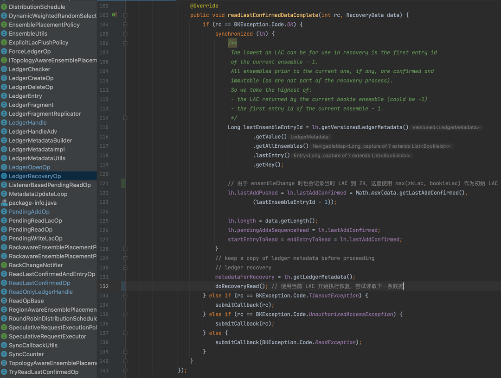

发起读请求：

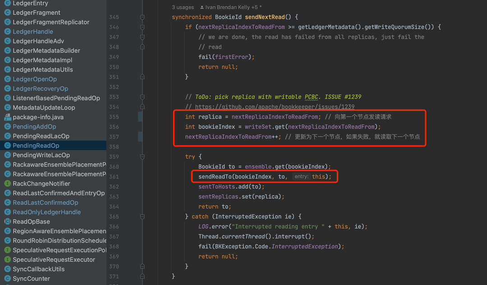

返回失败后，向下一个节点发送读请求，如果收到 Qf 个不存在响应，恢复终止：

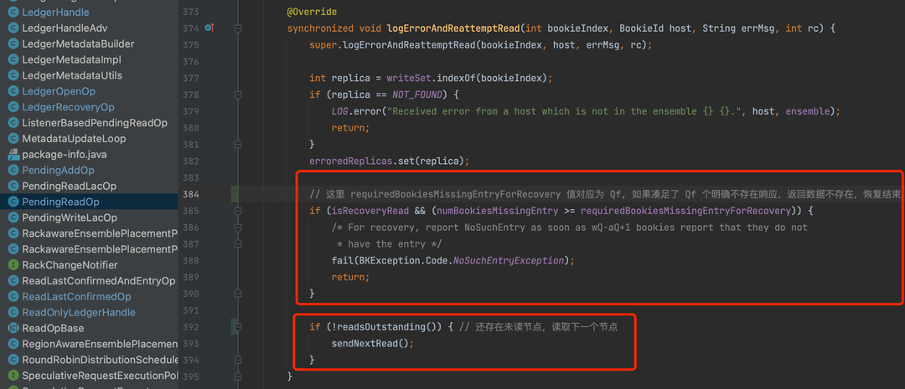

- 读取成功（包含失败重试其他节点）：回写这条数据回 Bookie（LAC 自然推进），触发下一条数据恢复；
- 读取失败（Qf 个节点明确返回数据不存在）：当前 LAC 就为需要恢复的真正 LAC，恢复成功。

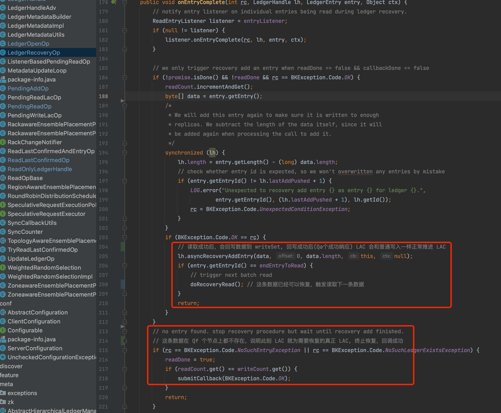

## 7. 消费

消费逻辑相对简单，当前 Ledger 在写入时，只有当前写入的客户端可以读取数据，使用内存中的 LAC 防止读取越线。

其他客户端只能读取已关闭的 Ledger，首先从 ZK 中获取元数据（包含 LAC），然后正常向对应 Bookie 发起请求即可，失败后尝试下一个 Bookie 节点，直到成功或者所有节点都尝试过。恢复 LAC 的读取过程和正常读取数据使用同一套逻辑，且相对简单，这里就不做代码分析。

可以看到 BK 客户端读取消息是按单条消息来读取的，会造成请求数较多。高版本 BK 已经做了一定优化，客户端提供了批读能力，可以和服务端一次交互就读到多条消息。这里有个前提条件，就是数据不能条带化写入，因为条带化写入会让数据分散到多台节点，单台节点内数据不连续，所以生产环境还是建议配置 E=Qw=Qa。

## 8. 总结

本文主要从客户端视角分析 BK 一致性协议设计理念以及实现原理，包含 Ledger 创建、数据的写入、读取以及客户端服务端故障恢复等内容。可以看到 BK 的一致性协议还是有一些有趣的地方，并且实实在在地解决了一些问题，也能理解到 Pulsar 的存算分离并不是简单地加一层无状态代理层来实现的。
