# Apache InLong 使用 Pulsar 替换 Kafka 实践

> Apache Pulsar 是一个多租户、高性能的服务间消息传输解决方案，支持多租户、低延时、读写分离、跨地域复制（GEO replication）、快速扩容、灵活容错等特性。本文主要介绍 WeData 数据集成使用 Pulsar 逐步替换 Kafka 方案落地，以及在这个过程中遇到的问题、解决思路以及利弊对比分享。

## 目录

- [1. 背景](#1-背景)
  - [1.1 WeData 数据集成](#11-wedata-数据集成)
  - [1.2 大数据 MQ 当前运营现状](#12-大数据-mq-当前运营现状)
  - [1.3 Kafka 架构（CDMQ）](#13-kafka-架构cdmq)
- [2. 使用 Kafka 遇到的痛点](#2-使用-kafka-遇到的痛点)
  - [2.1 痛点 1 - Topic 有上限](#21-痛点-1---topic-有上限)
  - [2.2 痛点 2 - 单分区容量存在上限](#22-痛点-2---单分区容量存在上限)
  - [2.3 痛点 3 - 磁盘使用不均](#23-痛点-3---磁盘使用不均)
  - [2.4 痛点 4 - 存储压力](#24-痛点-4---存储压力)
  - [2.5 痛点 5 - 扩缩容故障屏蔽不灵活](#25-痛点-5---扩缩容故障屏蔽不灵活)
  - [2.6 痛点 6 - 分区数限制消费速率](#26-痛点-6---分区数限制消费速率)
  - [2.7 痛点 7 - 仅支持流模式消费](#27-痛点-7---仅支持流模式消费)
- [3. Pulsar 带来的优势与不足](#3-pulsar-带来的优势与不足)
  - [3.1 Topic 数量上限高](#31-topic-数量上限高)
  - [3.2 外部一致性协议](#32-外部一致性协议)
  - [3.3 存储天然均衡](#33-存储天然均衡)
  - [3.4 快速扩缩容 & 高可用](#34-快速扩缩容--高可用)
  - [3.5 Pulsar 消费](#35-pulsar-消费)
  - [3.6 InLong Pulsar 消费 - 进程级别内存限制](#36-inlong-pulsar-消费---进程级别内存限制)
- [4. Kafka 和 Pulsar 的区别](#4-kafka-和-pulsar-的区别)
- [5. Pulsar 带来的新挑战](#5-pulsar-带来的新挑战)
- [6. 未来规划](#6-未来规划)

## 1. 背景

### 1.1 WeData 数据集成

WeData 是一体化全链路大数据开发治理平台，基于天穹大数据基础能力的积累，结合内网各业务痛点，融合了包含数据集成、数据研发、数据探索、数据资产等能力。WeData 数据集成完全基于 Apache InLong 构建，先简单介绍一下 InLong 数据集成平台。

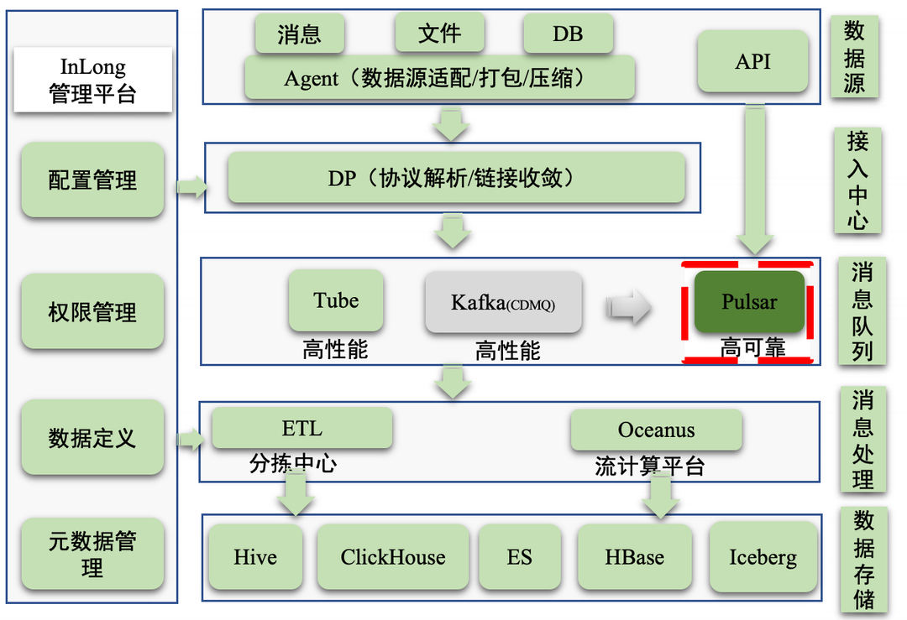

Apache InLong（应龙）是一个一站式、全场景海量数据集成框架，同时支持数据接入、数据同步和数据订阅，提供自动、安全、可靠和高性能的数据传输能力，同时支持批和流，方便业务构建基于流式的数据分析、建模和应用。从图中可以看到，大数据平台所有的消息队列（MQ）都包含在 InLong 模块。

InLong 内部数据暂存在 MQ，支持 Tube、Kafka 和 Pulsar。目前，InLong 内部 Kafka 已经全部被 Pulsar 所取代，只剩下 Tube 和 Pulsar 两种 MQ。Tube 主要用于大数据场景，即数据可用性场景，它采用单副本存储，成本低且性能强大。用户需要更高的数据可靠性时可选择 Pulsar 组件，Pulsar 能够提供高度可靠且高性能的数据处理能力，当然，相对于 Tube MQ，其成本会稍高一些。

### 1.2 大数据 MQ 当前运营现状

| MQ                    | 条数/天 | 大小/天  |
| --------------------- | ------- | -------- |
| Tube                  | 百万亿  | 十 PB 级 |
| Kafka（CDMQ，停新增） | 十万亿  | PB 级    |
| Pulsar                | 十万亿  | PB 级    |

Tube 每日的数据写入量已超越百万亿级别，消息总量达到数十 PB。Kafka 大数据场景已经全部迁移至 Pulsar，只剩下业务中间件场景。

### 1.3 Kafka 架构（CDMQ）

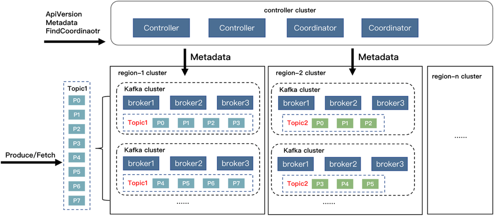

原生 Kafka 的使用维护成本相对较高，并且在集群扩容或故障屏蔽方面存在一些不足。因此，基于社区版本，我们对 Kafka 进行了改进，引入了联邦机制（上图所示）：使用多个物理 Kafka 集群联合成一个联邦集群，统一对外提供服务。

这种架构使得能够以子集群（也就是物理集群）的粒度资源化管理服务，同时也方便在子集群级别进行故障屏蔽、扩缩容等操作。这个改进后的架构目前仍然在使用中，下文中提到的 Kafka，指的都是该架构。

## 2. 使用 Kafka 遇到的痛点

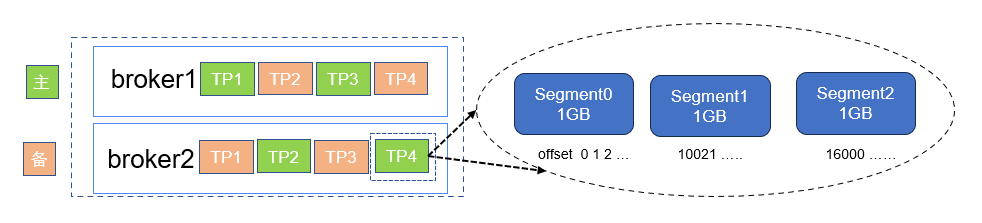

如上图所示，Kafka 的每个分区副本分布在不同的机器上，每个分区由一组数据文件（segment）组成。数据总是写入到最后一个文件，而读取则可以访问任意位置的文件。

### 2.1 痛点 1 - Topic 有上限

由于 Kafka 单分区数据都由一组文件组成，当 Topic 数量或分区数量庞大时，这种机制会带来一个显著问题：磁盘上会出现大量的文件组，导致 IO 操作变得随机，严重影响性能。

之前的测试当单块 HDD（机械硬盘）磁盘上的分区数从 64 增加到 256 时，吞吐量会下降一半以上。所以在使用 Kafka 时，需要严格限制分区的数量。由于 Kafka 的分区数或 Topic 数有限制，在 InLong 内部使用 Kafka 时，需要将多个数据流合并写入到一个 Topic 中。这种合并操作需要 InLong 内部为生产和消费分别引入一个服务来维护数据流到 Topic 的映射关系，这无疑增加了系统的复杂性。

### 2.2 痛点 2 - 单分区容量存在上限

Kafka 每个分区只能存储在单个目录里，也就是单分区最大容量上限为单块盘容量，如果分区存在数据热点，很快就能写满单块盘。所以我们在部署上把全部盘 RAID 化成一块盘来使用，单分区容量上限扩大为单台物理机上限。

### 2.3 痛点 3 - 磁盘使用不均

即使单分区可以使用到节点的全部存储，但是不同 Topic 之间流量差异过大，还是很容易出现单机磁盘热点，所以我们限制了每个 Topic 分区数量必须为节点数的倍数，保证每台节点上都均匀承担每个 Topic 的分区。这样虽然解决了磁盘不均问题，但是无疑加剧了分区的消耗。

### 2.4 痛点 4 - 存储压力

熟悉 Kafka 的同学都知道，Kafka 需要最少三副本才能同时保证高可用和高可靠（允许单台节点故障，任何时刻至少两个节点可用）。配置如下：

```properties
acks=all                                      # 客户端参数
min.insync.replicas > 1                       # 至少为 2
replication.factor > min.insync.replicas      # 至少为 3
```

这个特点是有点反直觉的，朴素的想法是两副本就足够，也就是每条消息都写两副本，单节点故障后，还能剩下一台节点的数据提供读服务，后续的消息再重新选择集群内其他好的节点写入即可。至于故障后单副本的数据是否需要复制一份到其他节点是一个锦上添花的事情，不影响主流程。

先简单看一下 Kafka 工作原理。在这之前，需要了解 Kafka 几个最基本的概念：

- **AR（Assigned Replicas）**：每个分区分配的全部副本集合；
- **ISR（In-Sync Replicas）**：健康的副本，指与 Leader 副本保持同步的 Follower 副本集合（包含 Leader 副本）。只有处于 ISR 中的副本才会被认为是同步的，其他副本将被视为不可靠的。当 Follower 副本无法及时跟上 Leader 副本的同步进度时，它将被移出 ISR，直到它能够追赶上来。ISR 机制确保了数据的一致性和可靠性；
- **OSR（Out-of-Sync Replicas）**：不健康的副本，指与 Leader 副本不同步的 Follower 副本集合。当 Follower 副本无法及时跟上 Leader 副本的同步进度时，它将被移出 ISR，并被标记为 OSR。OSR 副本将尝试追赶上来，一旦追赶上来并与 Leader 副本保持同步，它将被重新添加到 ISR 中；
- **Leader**：副本中提供读写服务的副本，故障后，其他副本会被选为 Leader；
- **Follower**：除了 Leader 副本外的其他副本。

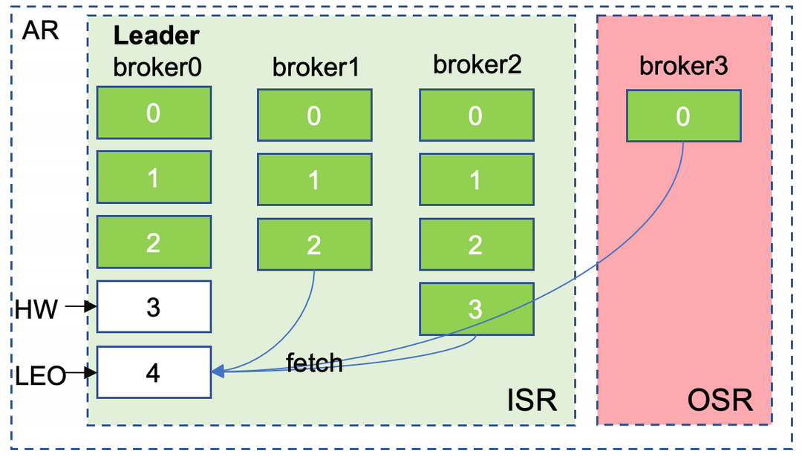

上图为 Kafka 数据流向，客户端发送数据到 Leader 副本，等待所有 ISR 副本同步完数据后，Leader 副本会向客户端发送 Ack 消息标识一条消息写入成功。Kafka 使用类 Raft 的日志复制协议来同步数据，要求副本必须拥有完整数据才能成为健康的节点对外提供服务。

如上图，Broker 3 副本目前处于 OSR 列表，只同步了部分数据，比如只同步到 0 号数据，而 Leader 当前已写入 4 号数据，即使该节点恢复正常，也无法立即写入 4 号数据。Broker 3 想写入 4 号数据的前提是需要先同步完历史数据（0-3 号）。这就是 Kafka 一致性协议的一个显著弊端：副本必须具备全部数据才能提供服务（读或写）。

这一特点对使用产生了很多方面的限制。为了保证每条消息都能成功写入两副本，`min.insync.replicas` 至少为 2，`replication.factor` 副本数至少为 3，才能容忍单节点故障后仍有两个可用的副本。所有类 Raft 日志复制一致性算法都会存在这样的问题，只不过大多数场景比如 ZK，存储数据量不大，对存储消耗不敏感。而 MQ 场景瓶颈基本在磁盘，满负荷几小时就能写满存储节点，存储多一个副本成本是非常敏感的。InLong 内部 Kafka 为了成本考虑放弃异常时一致性保证，使用 AP 模式，分区默认两副本，`min.insync.replicas=1`。

### 2.5 痛点 5 - 扩缩容故障屏蔽不灵活

由于 Kafka 一致性协议要求副本需要完整的数据才能正常提供服务，在扩缩容及故障屏蔽场景也会受到一定的限制。当业务流量增加到集群规格上限时，通过增加机器来扩展集群规模，例如从原有的 10 台机器扩展到 20 台。然而，新加入的机器由于没有数据，无法立即对外服务，这就导致了新节点无法快速分担服务压力。

这个时候有两个选择：一是将老节点上的数据分区迁移到新节点上，二是在新节点上直接创建新的数据分区。但这两种方法都会有一点点瑕疵。如果选择方案 1，那么这个过程将会非常耗时，尤其是在数据量巨大且业务流量激增的情况下，迁移数据可能需要数小时甚至数天，同时还会产生额外的网络流量，进一步影响用户的读写性能。此外，如果集群本身就已经满载运行，再进行数据迁移和流量增加，可能会对业务造成更大的冲击。因此，我们更倾向于选择第二种方案，即在新节点上直接创建新的分区。由于新分区没有历史数据需要同步，可以立即对外提供服务。这种方法的优点是简单易行，只需扩展分区即可，但缺点是会增加分区的数量。

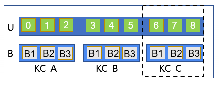

在缩容过程中，假设需要将集群规模从 20 台机器缩减到 10 台，那么就需要将新节点上的分区迁移回老节点。这个过程同样涉及到数据迁移的问题，其成本和挑战与前面提到的数据迁移相似。为了解决这个问题，我们在 Kafka 的基础上进行了一些改进，开发了一种集群分区缩减的方式：对于需要缩容的分区，可以直接在新节点上删除，但在此之前会先进行禁写操作，以确保数据不会丢失。例如，如果 Topic 的保存周期是一天，会先禁止写入，等待一天后数据基本消费完毕，再删除分区。

缩容场景与故障屏蔽场景类似。假设新扩展的 KC_B 集群出现问题，可以直接以子集群为粒度进行禁写操作，让用户只能向 KC_A 集群写入数据，但仍然可以消费 KC_B 集群上的历史数据。

可以看到由于 Kafka 的一致性协议限制，扩缩容、故障屏蔽会引起分区变化。InLong 内部生产和消费进行了比较好的适配，可以动态感知到分区的变化，对业务影响几乎没有。但是在业务场景中，由于用户使用的 SDK 版本各异，一些低版本的 SDK，或者 Flink 等没有开启分区自动感知，可能会无法感知到分区的变化，这就会带来一些问题。

例如，在扩容场景中，如果消费者感知不到新的分区，但是生产者可能已经将数据写入新的分区，但消费者仍然只消费老分区的数据，从而导致数据丢失。目前，还没有更好的方式来预判这个问题的出现，只能在变更后通过监控发现这种问题，并通知用户进行重启以感知新的分区并优化客户端程序。

在缩容或禁读禁写场景中，如果某个集群出现故障并被禁写，那么该集群上的分区将无法提供服务。这也会对用户产生影响，尤其是对于那些按 key 写入数据的用户来说，为了保持消息的顺序性，客户端会不断尝试写入被禁写的分区，从而导致写入操作被卡住；如果选择新的分区进行写入，整个流程的顺序就无法保证。

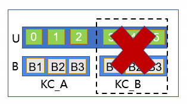

简单来说，在 Kafka 进行的快速扩缩容和禁读写会带来分区数量变化，会造成某些业务场景中使用时受到一些限制。

### 2.6 痛点 6 - 分区数限制消费速率

Kafka 的消费模型比较简单，消费者主动从 Kafka 中拉取数据。由于采用 Pull 模式以及为了保证消息顺序性，Kafka 的分区只能被同一消费组内一个消费者消费。

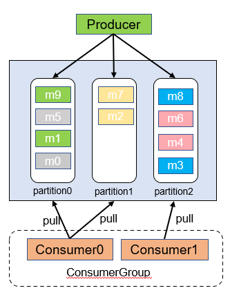

上图简单描述了 Kafka 是如何保证消息顺序性：Kafka 消息投递是在客户端按照 key hash 选择分区，相同的 key 的消息会被写入到同一个分区中；消费者在分区的分配过程中，一个分区只会被分配给一个 Consumer，这样可以确保单个分区的数据能够被有序消费，从而保证整条链路的顺序性。

然而，这种消费模式也带来了一些限制：消费的吞吐量实际上受到了分区数量的限制。例如，如果有三个分区，那么最多只能有三个消费者同时消费，以确保有序性。若想提高消费吞吐量，就需要增加分区数量，但 Kafka 的分区数量是有限制的。有些情况下，为了满足吞吐量需求，不得不增加分区数量，这可能对集群造成一定压力。在线上场景中，有些 Topic 的分区数甚至超过了 1 万，这是因为消息处理过程较慢，需要更多的分区来提高吞吐量，以确保生产与消费的平衡。

在 InLong 内部，由于没有保序的需求，所以是将消息放入一个共享池中，并使用多线程进行处理。虽然这样做牺牲了消息的有序性，但确实显著提高了吞吐量。然而，由于这种流式消费模式，在确认（Ack）消息时需要格外小心，只能确认最小连续的 Offset，因此需要一套相对复杂的逻辑来决定每次 ack 的位置。

此外，Kafka 中的消费者变化和分区变化都会导致分区的重新分配，这个过程被称为 Rebalance。无论是消费者数量变化还是分区的变化，都会触发 rebalance。同时，由于 Kafka 采用 Pull 模式，整个消费过程完全由客户端主导，服务端很难排查消费组频繁 rebalance 问题。比如消费者在正常处理消息时，发生了网络抖动随后恢复，由于有一小段时间未拉取新消息，服务端会积累大量待消费的消息；当客户端恢复后，会一次性收到大量消息包，这可能导致本地内存或者下游处理服务压力骤增，无法在短时间内处理完毕；如果超过了一定时间阈值，Kafka 会认为该消费者节点出现问题而将其踢出，进而触发 Rebalance。在这种情况下，消费可能会陷入恶性循环，导致无法恢复。

因此，Kafka 在某些情况下会表现出不稳定性，如网络抖动或客户端、服务端的瞬时抖动都可能导致消费不稳定和频繁的 Rebalance。而由于其 Pull 模式和客户端主导的特性，服务端很难排查这些问题。

### 2.7 痛点 7 - 仅支持流模式消费

Kafka 最初的应用场景是日志同步，所以仅支持流模式，不支持队列模式。消费从前往后消费（可以重置 offset 到指定位置），仅支持累积确认（Cumulative ack），ack 了某个位置就认为这个位置之前的数据都已经消费。不支持消息重试，如下图所示，用户消费到第 29 号数据时处理异常，Kafka 并不支持重试或重新推送这条数据，除非在客户端进行循环处理，一直处理到第 29 号数据成功后再继续拉取后续数据。然而，这种方法可能并不实际，因为某些消息可能由于各种原因而无法被成功处理。在 Kafka 的这种模式下，它并没有提供更为灵活的处理方式，消费者只能不断重试，导致后续消息无法被及时消费。

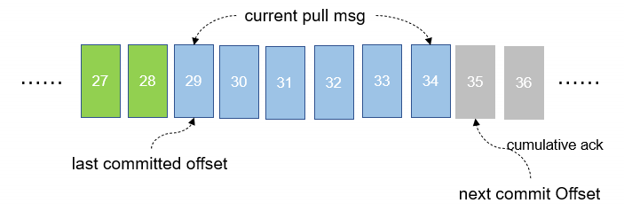

Spring-Kafka 2.7 插件在客户端支持了重试和死信队列功能，需要服务端创建额外的 Topic 来存放需要重试或死信的数据，但是在使用时会有一些限制。

## 3. Pulsar 带来的优势与不足

### 3.1 Topic 数量上限高

上文中说到 Kafka 每个分区是单独文件，分区数失控时磁盘读写性能急剧下降。而 Pulsar（Bookie）则采用了一种集中化的方式：写入时所有分区的数据都写到 WAL 后给客户端返回 ACK，随后会在内存中按分区数据 group，写入到数据文件中。所有的分区数据都会写入同一组数据文件中，这样就能解决文件数失控带来的随机 IO 问题。

当然这种方式也有不足之处：在读取数据时，由于所有数据都存储在一组文件中，因此读取过程可能会变得随机，即使 Pulsar 在内部做了一些优化，但是读性能还是会略低于顺序读写的 Kafka；再者，由于一个文件内可能包含多个 Topic 的数据，当某些数据过期时，Pulsar 需要将未过期的数据筛选并整合到新的文件中（compaction），compaction 过程也会产生额外的 IO。

由于 Pulsar 没有明显的 Topic 上限，替换 Kafka 的 InLong 系统中，每个数据流都可以独占一个 Topic，之前维护数据流和 Topic 映射关系的服务也不再需要，降低了系统的复杂度。

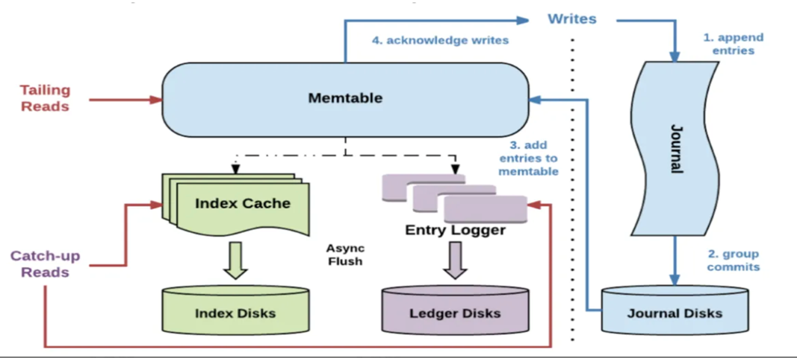

### 3.2 外部一致性协议

Pulsar 的存算分离设计独特且颇具创新，它并非简单添加一个代理层或 Broker 来实现。在 Pulsar 中，当数据通过 SDK 写入 Broker 时，Broker 内置的 BK 客户端会并行地将这些数据写入到 Bookie 上。若设置为两个副本，数据会同时在两个 Bookie 进行备份，且此过程不增加额外时延。与 Kafka 相比，尽管 Pulsar 引入了一个无状态的代理层，但得益于其架构设计，数据传递仍然只需两个网络周期，这是因为数据是并行发送到 Bookie 的，从而保证了低时延。

回顾之前提到的 Kafka 的一个主要问题：副本需要完整的数据集才能提供服务，这带来了很多限制。然而，Pulsar 有效地解决了这一问题。在 Pulsar 中，如果数据写入 Bookie 0 和 Bookie 1 时，比如写入 Bookie 1 失败，系统可以直接选择新的节点继续写入，这个过程在 Pulsar 中被称为 EnsembleChange。Pulsar 的 Ledger 元数据存储了每次写入的状态，因此即使副本不具备全量数据，也能对外提供服务。例如，如果想读取旧数据，元数据会指引你去相应的 Bookie 上读取；对于新数据，元数据同样会提供指引。这一特性使得 Pulsar 在数据副本管理上更加灵活高效。

上文中提到在使用 Kafka 时，为了降低成本，我们选择 AP 模式，这意味着虽然副本配置为 2，但实际上许多线上分区只有一个健康的节点（通常是 Leader 节点）提供服务，如果 Leader 节点出现故障，数据可能会丢失。Pulsar 在这方面具有显著优势，因为它只需要两份数据就能实现高可用性和高可靠性。

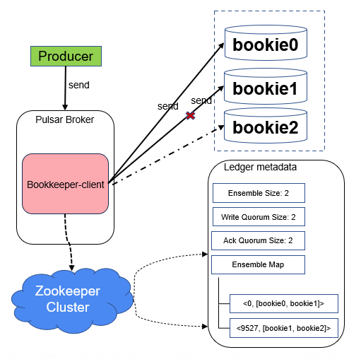

### 3.3 存储天然均衡

简而言之，Pulsar 无需之前的数据就能提供服务，因此所有数据都可以均衡地分布在 Bookie 上。例如，当一个分区写满 1G 后，下一个 Ledger 或 Segment 可以选择其他 Bookie 进行写入，这样即使集群内只有一个分区，都可以充分利用整个集群的存储资源。相比之下，Kafka 需要完整的数据集才能提供服务，因此分区数据无法分散存储。所以在使用 Pulsar 时，分区配置会更加灵活；相比在 Kafka 中，为了消费吞吐量和磁盘均衡，不得不设置较大的分区数。

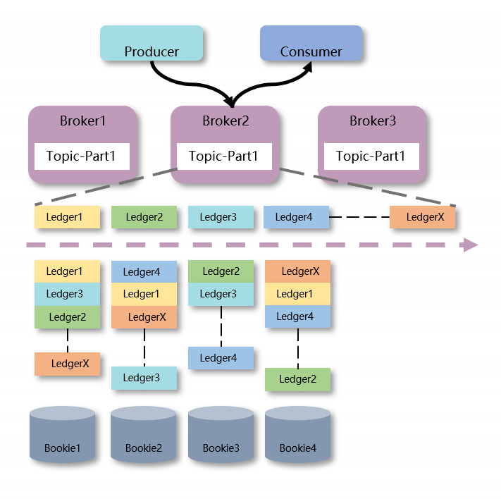

### 3.4 快速扩缩容 & 高可用

得益于 Pulsar 的外部一致性协议，它无需依赖数据即可对外提供服务，这使得其 Broker 层和 BK 层的扩展与缩减、高可用性以及节点组件的屏蔽变得异常灵活轻便。Broker 层本身无状态，因此可以轻松切换；而对于 BK 层，由于其扩容不需要以往数据，因此当新节点加入后，下一个 Ledger 可以直接选择新节点进行写入，这相较于 Kafka 在运营上有显著的提升。

此外，在进行集群扩展或缩减时，Pulsar 不会引起分区数的变化。如前所述，Kafka 为避免数据迁移，通过改变分区来实现目标，但这对用户而言并非完全透明，而 Pulsar 则能基本实现对用户的透明性。

### 3.5 Pulsar 消费

Kafka 的消费模式可以理解为基于分区维度，即每个分区只能被一个消费者消费，为了保序，相同 key 的消息只需要路由到相同分区即可。Pulsar 为了实现多个消费者能同时消费同一个分区，在消费处理上控制得更为精细。如下图所示，在生产端，如果数据包含 Key 或配置了 Order Key，Pulsar 会根据这些 Key 将数据路由到对应的分区，然后在每个分区内部，再使用一个 KeyBasedBatcher 来组织数据，确保所有相同 Key 的数据最终放入同一个 Batch（entry）中。在消费侧，由于数据已经按照 Key 组织好，服务端可以按 Key 将数据推送给不同的消费者。

这一过程中，不需要像 Kafka 那样进行 Rebalance，因此消费基本不会中断，即使消费者数量或分区数发生变化，也不会导致数据流中断。当然，在实现上还有很多复杂的细节需要考虑，比如新的消费者注册后，为了保序，需要等待之前的消费者把已推送的数据都 ack 后才向新消费者推送数据。Pulsar 细粒度的消费控制可以让多消费者共享同一个分区，解决了 Kafka 分区数限制消费吞吐量的问题。

此外，Pulsar 不仅仅支持流模式消费，还支持队列模式，允许单点 Ack，并提供丰富的重试机制和死信队列功能，而这些都不需要外部框架或者客户端进行适配支持。

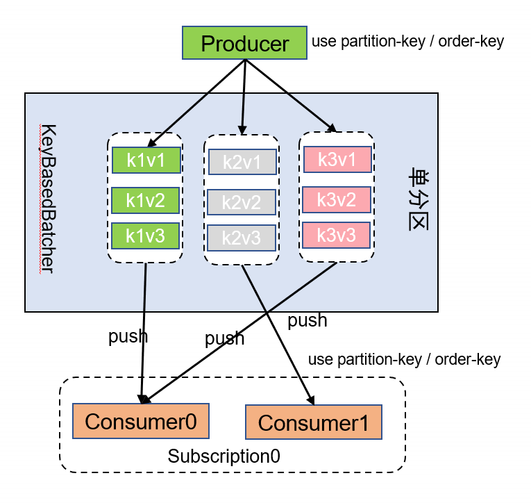

### 3.6 InLong Pulsar 消费 - 进程级别内存限制

在 InLong 内部，DataProxy 模块负责将数据写入 MQ，而 ETL 层则负责消费处理这些数据。一个 ETL 进程需要同时消费多个 Pulsar 集群的数据。我们发现随着分区数的增加，服务稳定性会有较大的波动，后来分析发现是由于 Pulsar SDK 内部每个分区独立工作，导致内存消耗与分区数呈正相关增长。所以我们做了一个进程级别的内存控制，让单进程内所有集群的所有消费者都受限于一个全局的内存限制。

## 4. Kafka 和 Pulsar 的区别

简而言之，在功能方面，Kafka 在设计上只支持流模式消费，Pulsar 不仅仅支持流模式，还支持队列模式，所以 Pulsar 拥有丰富的消息重推机制、单条确认、延迟消息等等功能。

而两者最大的区别还是在于数据一致性协议：Kafka 采用类 Raft 方式的日志复制协议，所有副本的数据都会保持和 Leader 副本完全相同，副本需要同步完全部数据才能对外提供服务，也就是这种存算一体架构让 Kafka 在磁盘使用、扩缩容、故障屏蔽等方面会受到部分限制；而 Pulsar 另辟蹊径，在客户端实现了外部一致性协议，存算分离架构可以相对轻松解决这些问题。

在日常运营方面，Pulsar 基本可以做到开箱即用，部署便可立刻投入使用。而 Kafka 要想充分发挥性能，达到节点流量、存储均衡以及高效的生产与消费，这要求用户对 Kafka 有较全面的了解，同时还需要定期处理 Kafka 节点故障后引发的低副本，这也是为什么我们需要做成联邦架构以及建设很多外围工具来辅助运营 Kafka 的主因。

当然 Kafka 目前基本已经是流平台的事实标准，大数据各种组件的支持与兼容性也会更好一些，在特定场景也更能发挥出极致的读写性能。

## 5. Pulsar 带来的新挑战

在从 Kafka 切换到 Pulsar 后，面临了几个挑战。在 Kafka 中，分区副本列表是固定的，因此即使 ZK 发生故障，也不会对 Kafka 产生太大影响：只要不进行配置更改或节点故障，即使 ZK 暂时失效，不影响集群正常读写，定期修复 ZK 即可。

然而，Pulsar 的情况不同。Pulsar 一致性协议在客户端实现，客户端不具备存储能力，元数据存储强依赖 ZK。比如分区写满一个 Ledger 后，会创建新的 Ledger 来写入新数据，Ledger 列表需要同步存储到 ZK；同时，如果写入失败，它需要进行 EnsembleChange，这一过程产生的元数据变化也离不开 ZooKeeper。因此，ZooKeeper 一旦失效，整个 Pulsar 系统将无法提供服务。

另外，在大量追赶读取（Catch-up read）的场景下，Pulsar 整体服务可能会受到影响。虽然 Pulsar 的存储实现了局部有序，但在查询时仍是随机访问，这使得其追赶数据的性能还是无法达到顺序读写磁盘的 Kafka 水平。不过，目前正在试用 directIO 和 BatchRead 特性，初步测试显示，这些新特性可能会带来 20%-30% 的性能提升，我们将继续关注并规划相关优化措施。

## 6. 未来规划

上文中提到的一致性协议都是建立在使用多副本前提下，如果使用网盘或者对象存储作为存储，将数据一致性复杂性转移到成熟的外部组件，MQ 内只需保持单副本即可（可参考 AutoMQ）。后续我们也会在此方向上做一些探索。
