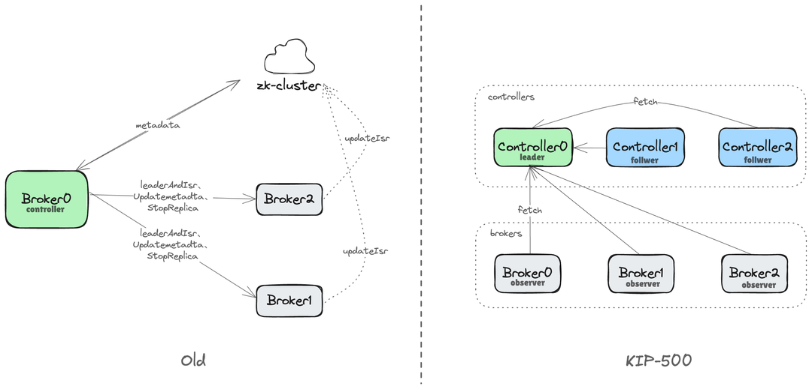
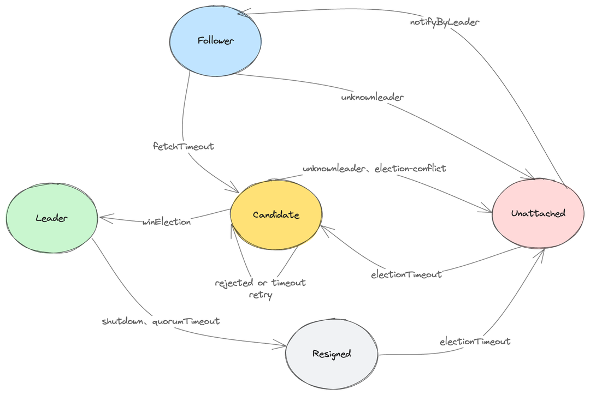
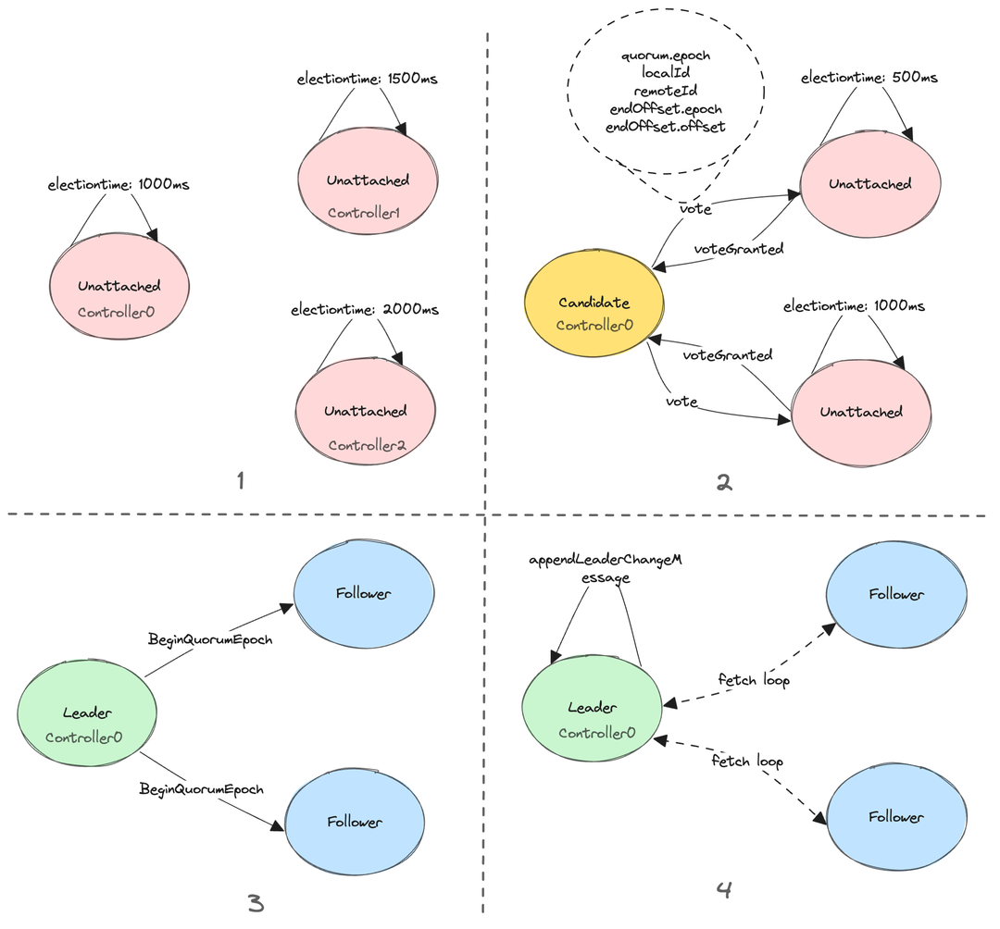
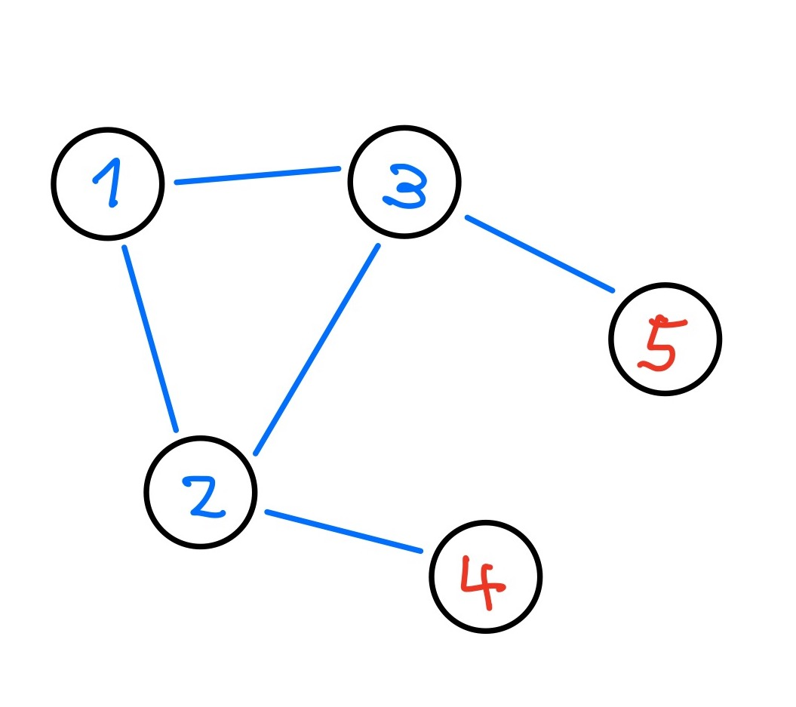
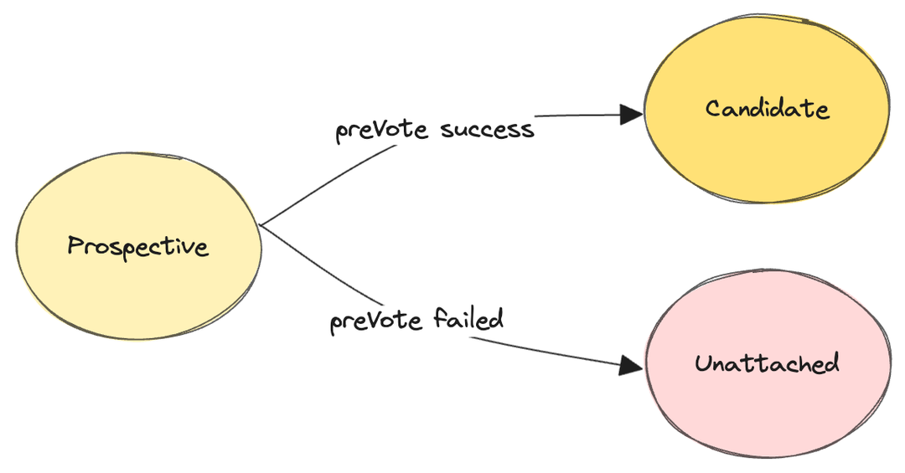
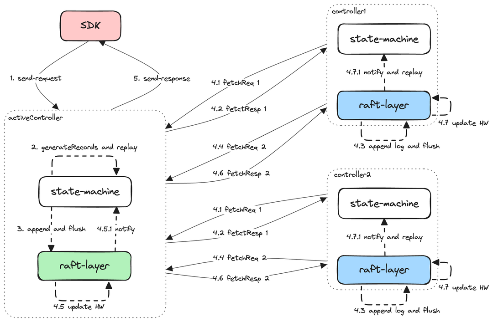
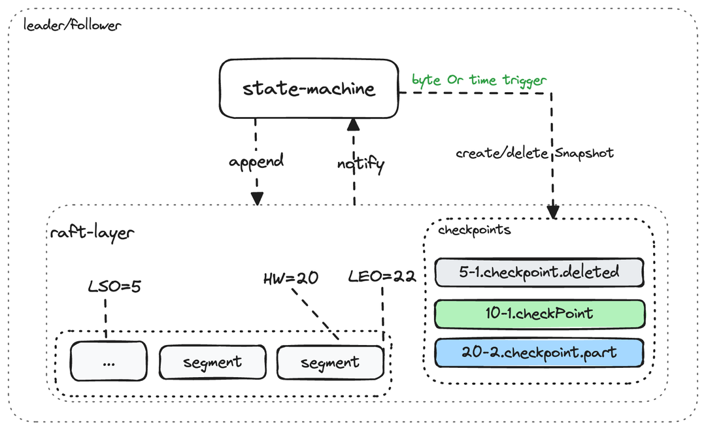
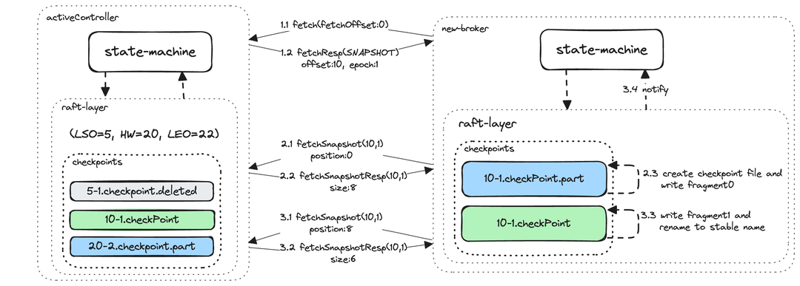
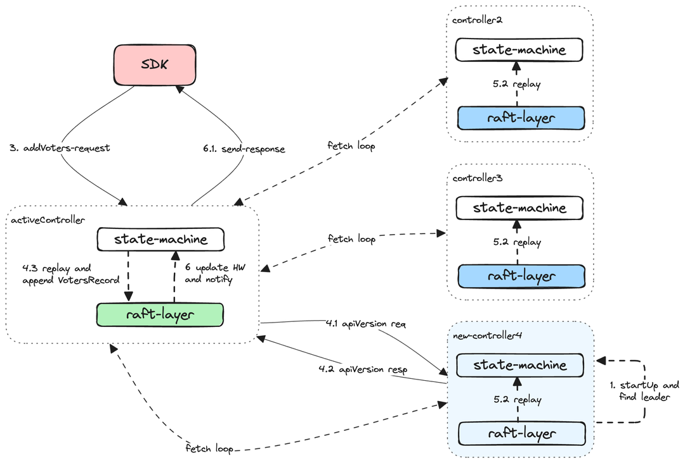
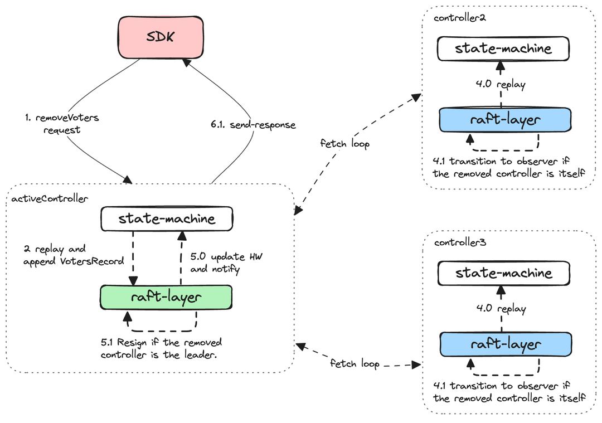

# Kafka 去除 Zookeeper - KRaft 实现解析

> Apache Kafka 是一个开源分布式流平台，优势在于其同时具备高可用、高性能、可弹性扩缩容等特性。目前在大数据领域已经成为 MQ 的事实标准。在其 2.8 版本以前都需要依赖 Zookeeper 组件（下文简称 ZK）来管理集群元数据信息。本文主要讲解在 Kafka 2.8（KIP-500）之后版本是去除 ZK 组件是如何实现的。

## 目录

- [1. 背景](#1-背景)
- [2. KRaft](#2-kraft)
  - [2.1 部署方式](#21-部署方式)
  - [2.2 简述](#22-简述)
  - [2.3 术语对比](#23-术语对比)
- [3. 选举](#3-选举)
  - [3.1 状态机](#31-状态机)
  - [3.2 选举时机](#32-选举时机)
  - [3.3 如何选举](#33-如何选举)
  - [3.4 预投票（Pre-Vote）](#34-预投票pre-vote)
- [4. 同步数据](#4-同步数据)
  - [4.1 数据同步](#41-数据同步)
  - [4.2 元数据事务](#42-元数据事务)
- [5. Snapshot](#5-snapshot)
  - [5.1 生命周期](#51-生命周期)
  - [5.2 快照同步](#52-快照同步)
  - [5.3 何时推进 LSO](#53-何时推进-lso)
- [6. 成员变更](#6-成员变更)
  - [6.1 新增节点](#61-新增节点)
  - [6.2 删除节点](#62-删除节点)
  - [6.3 单成员变更不足](#63-单成员变更不足)
- [7. 总结](#7-总结)
- [参考](#参考)

## 1. 背景

Kafka 低版本中对 ZK 依赖很重，Offset 也存储在 ZK 中。后续的版本逐步去除对 ZK 的依赖，Offset 以及配置信息逐步收敛到内部 Topic。在 KIP-500 之前的较新版本，只使用 ZK 来选举 Controller 节点以及一些必要的配置信息（包含 ISR 信息等）。

由于 ZK 的架构限制，导致 ZK 在性能上无法支持高吞吐数据快速读写。比如 Controller 节点切换后需要从 ZK 读取大量数据，会导致一段时间服务不可用，从而限制了 Kafka 集群分区数的上限。同时 ZK 数据变化使用 Watch 机制，有事件变化后会回调到客户端，然后读取最新 ZK 信息进行处理。由于事件回调和读取 ZK 信息存在时间差，有可能读取到的信息和 ZK 回调时已经发生了变化。同时 ZK 的 Watch 机制也无法保证一定及时触发，在极端情况下会导致 Broker 和 ZK 的数据不一致。所以 Kafka 去除 ZK 是有足够的必要性，去除 ZK 后，也能降低部署的复杂性以及运维成本。

同时使用 MQ 来实现一致性协议也比较合适，MQ 自带存储。一致性协议的主要能力就是 Leader 选举、数据复制、节点变更。当前 Kafka 内部已经具备了数据同步和副本变更的逻辑（与 Kafka 分区数据同步逻辑基本一致），很多逻辑可以得到复用。

所以 Kafka 在 2.8 版本后支持使用 Raft 协议来做自身元数据管理（数据同步协议保持不变），去除了对 ZK 组件的依赖，Kafka 实现的一致性协议称为 KRaft。由于篇幅有限且 Raft 协议本身已经有很多优秀的资料，本文会聚焦于 KRaft 的特点以及实现方式。

## 2. KRaft

### 2.1 部署方式

KIP-500 版本以后，Kafka 的部署模式变得更简单，完全无需依赖外部组件，最简化场景可以做到单机单进程部署。



低版本如上图左侧所示，Kafka Broker 会在启动时使用 ZK 选举出一台特殊的 Broker 节点（称为 Controller 节点，同时具备 Broker 全部读写功能），Controller 节点统一管理集群所需的元数据并收敛了绝大多数与 ZK 的交互。节点选举成 Controller 后，会从 ZK 加载元数据到内存中，为每个分区选举出 Leader 并通过一些特殊 RPC 命令（LeaderAndIsr、UpdateMetadata、StopReplica）把元数据通知到全部 Broker 节点，让 Broker 可以正常开始读写工作。

KIP-500 后版本如上图右侧，去除了 ZK 组件依赖，内部闭环掉元数据管理。

每台节点可以单独作为 Broker 或者 Controller 角色，也可同时包含两者（上图中 Broker 和 Controller 单独部署，生产可混合部署节约资源）。

```properties
# The role of this server. Setting this puts us in KRaft mode
process.roles=broker,controller
```

只有配置包含 `controller` 的节点才能参加选举（Raft voter），成功选举为 Leader 的 Controller 节点被称为 ActiveController（KRaft 协议中的 Leader，Controller 为静态角色，ActiveController 为动态角色）。`process.roles` 不包含 `controller` 的普通 Broker 节点在 KRaft 协议中作为 Observer（不参与投票和消息提交，只能同步数据并根据这些元数据来指导工作）。

KRaft 内部使用名为 `__cluster_metadata-0` 的单分区 Topic 作为复制日志（复用普通分区逻辑），选举出的 ActiveController 节点也就是该分区的 Leader（当前还没有支持 multi-raft）。

### 2.2 简述

接下来了解一下 KRaft 是如何工作的。标准 Raft 工作原理就是在多个节点中选择出一个 Leader 节点，只有 Leader 节点允许用户写数据，然后 Leader 与 Follower、Observer 通过一些交互来保持数据同步和数据一致性，即使在一些极端情况下还需要能保证数据的安全性（少量节点故障）。

KRaft 大体上参考了 Raft 论文来实现，最大的不同点在于 Raft 使用 Push 模式，无论是心跳还是数据的同步都是 Leader 节点主导，而 KRaft 协议则沿用 Kafka 分区数据复制的 Pull 模式，由 Follower 节点来主导数据复制和心跳。这里讨论的 Pull or Push 模式与 MQ 消息消费的 Pull or Push 模式是一样的，两种模式本质上不会有很大区别，底层实现都是挂着长连接，在消息的吞吐、时延以及流控上面上都有各自的一些优化手段。

### 2.3 术语对比

KRaft 部分命名没有使用 Raft 命名，而是沿用了之前的 MQ 术语。下文中都会使用 KRaft 术语。术语如下：

| 类型 | KRaft | Raft | 描述 |
| --- | --- | --- | --- |
| 角色 | voter | voter | 参与投票和消息提交的角色，包含 controller 角色的 Kafka 节点 |
| 角色 | observer | non-voting | 不参与投票和消息提交角色，只能同步数据，只包含 Broker 角色的 Kafka 节点；相当于 Paxos 中的 learner |
| 状态 | leader | leader | 有写权限 |
| 状态 | follower | follower | 无写权限 |
| 状态 | candidate | candidate | 可发起正式投票 |
| 状态 | resigned | N/A | 刚退出 leader 状态（优雅停机） |
| 状态 | unattached | N/A | 初始状态，不能做任何操作 |
| 状态 | prospective | N/A | 可发起预投票 |
| 参数 | epoch | term | 任期，每次选举 +1 |
| 参数 | logStartOffset(LSO) | first index | 日志最开始位置 |
| 参数 | logEndOffset(LEO) | lastLogIndex | 日志中最后位置，Kafka 中是最后位置 + 1 |
| 参数 | highWatermark(HW) | commitIndex | 已提交的位置（可读的位置） |
| 参数 | lastStableOffset | N/A | 事务状态下可读的位置，<= HW |

刚接触 Raft 可能会容易把 observer 角色和 leader、follower 状态混在一起看待，observer 只是不能参与投票和消息提交的静态角色，observer 在 KRaft 中也可以处于不同的状态（比如 unattached、follower 状态，由于不能选举，所以不会切换到其他状态）。

## 3. 选举

KRaft 协议第一步就是快速选举出一个有全部已提交消息的 Leader 节点。

### 3.1 状态机

在介绍选举之前，需要先介绍节点的各种状态，状态如下：

- **LeaderState**：已经选举成为最新 Epoch 的 Leader 状态；
- **FollowerState**：Follower or Observer 共用这个状态，实时同步 Leader 的数据，可以处理客户端读请求；
- **CandidateState**：可投票的状态；
- **ResignedState**（优雅退出）：Leader 重启后的状态或者是 Leader 节点计划退出时的状态。该状态会让出 Leader 身份并通知其他节点，避免集群需要等待心跳时间后才能重新选举；
- **UnattachedState**：还未能选举阶段，例如刚启动，等待一段时间后会自动转为 CandidateState 状态。

下图展示了这些状态和它们之间的转换关系，这些转换关系会在接下来进行讨论。



简单来说，KRaft 相对于 Raft 多了两个状态，ResignedState 状态用来做优雅停止，UnattachedState 状态作为初始状态（Raft 中使用 Follower 作为初始状态）。

### 3.2 选举时机

当集群中不存在可用的 Leader 时，就应该触发新一轮的 Leader 选举。在 Raft 协议中，Leader 节点会定期发送心跳探测请求到 Follower 节点以便能及时感知到 Follower 的最新状态，而 Pull 模式的 KRaft 则是 Follower 不断发送 FetchRequest 在同步数据，FetchRequest 也充当了心跳检测。下面这些场景中，会发起新一轮的选举：

- Follower 如果在 `quorum.fetch.timeout.ms` 之内都不能成功接收到 FetchResponse（包含重试）；
- Follower 接收到 Leader 节点发送的 EndQuorumEpochRequest；
- Candidate 在 `quorum.election.timeout.ms` 时间内没有选举成功，会重新发起下一轮选举。

这里有一个特殊场景，由于 KRaft 是 Pull 模式，Leader 节点没有定期发送心跳给 Follower 节点，而是被动接收 FetchRequest，如果发生网络隔离，Leader 将不能发现。所以 KRaft 实现中，如果 Leader 节点在 `1.5 * quorum.fetch.timeout.ms` 时间内没有接收到大多数节点的 FetchRequest，会主动退出 Leader，转换为 Resigned 状态并发送 EndQuorumEpochRequest 通知所有 Follower 节点。

### 3.3 如何选举

下面介绍一下选举过程。



如上图所示：

- **步骤 1**：有 3 个刚初始化的 Controller 节点，初始化状态都为 Unattached，Unattached 状态在没有外界影响的情况下，会随机在 1 倍 `quorum.election.timeout.ms` 到 2 倍 `quorum.election.timeout.ms` 时间内转变成 Candidate 状态；
- **步骤 2**：超时时间短的 Controller0 率先转变成 Candidate 状态，Epoch 自增，然后先投自己一票，接着发送 VoteRequest 给其余 Controller 节点。由于其他节点该 Epoch 还没有投过票，且 Controller0 的日志也不旧于自己本身的日志，就给 Controller0 投了票；
- **步骤 3**：Controller0 选举成 Leader 后，发送 BeginQuorumEpochRequest 给其余 Controller 节点，其余 Controller 节点转变为 Follower 状态（不发送给 Observer）；
- **步骤 4**：Leader 节点选举成功后往日志中写入一条 LeaderChangeRecord（Raft 中的 no-op），这条消息 Follower 节点不会读取，直接忽略掉，主要是为了快速推进 HW。原理可参考 Raft 短论文中的 5.4.2（Figure 8）。

KRaft 节点中每一次状态变更后都会 fsync 到本地 log 同一目录下名为 `quorum-state` 的文件中，最主要原因是需要保证每个 Epoch 下 Voter 只能投票给一个节点。比如以下场景：

1. 投票者同意某个 Candidate 后立即重启，收到其他节点的投票请求需要拒绝（相同 Epoch），否则会导致双 Leader；
2. 投票者同意某个 Candidate 后响应包丢了，该 Candidate 再次请求投票需要保持幂等同意。

同时重启后也需要能快速感知到之前的状态。比如该节点停掉之前为 Leader 状态，启动后会马上转换成 Resigned 状态，并发送 EndQuorumEpochRequest 给所有节点以便其他节点能立即发起下一轮的选举而无需等到选举时间超时。

### 3.4 预投票（Pre-Vote）

当某个 Voter 由于网络不稳定或者配置不合理（心跳过短等）导致被隔离在集群外，该 Voter 会不断自增 Epoch 并发起选举。在恢复网络后，会干扰到集群的其他节点，迫使其他节点参加不必要的选举，从而影响整个 Raft 集群的稳定性（选举过程中，服务不可用）。当 Raft 集群较大时会更加明显。

下面是一个经典例子，图中拓扑代表网络连通性。



图中节点 3 为 Leader，节点 4 由于不能和 Leader 通信，所以会使用更大的 Epoch 触发下一轮选举，会把节点 2 变成了 Unattached 状态。

节点 4 除了节点 2 不能与其他节点通信，最终会选举失败。但是节点 2 在超时后会发起选举，最终会选举成功。

节点 5 和节点 4 是完全相同的情况，也会导致节点 3 再次选举为 Leader，最终的结果就是 Leader 会在节点 2 和节点 3 直接横跳，导致集群基本不可用。解决的方案在 Raft 大论文中（4.2.3）有解释，称为预投票（Pre-Vote）。主体思想上比较简单，就是在每个节点正式发起选举之前先做预选举（不自增 Epoch），当收到大多数人的同意以后才发起正式的选举，这样可以避免不必要的选举对集群的干扰。

KRaft 实现上新增了 Prospective 状态，在这个状态的 Voter 会发起预投票。由于选举和收集选票逻辑基本一致，KRaft 复用了正式选举的逻辑，只是在 VoteRequest 中新增了 `preVote` 字段来标识是预投票还是正式投票。



可以看出支持 Pre-Vote 后 Candidate 状态，拆成了 Prospective + Candidate 两个状态，Candidate 状态只能由 Prospective 状态才能转换。Pre-Vote 类似于经典的 2PC 协议，避免了不必要的 Leader 选举。

## 4. 同步数据

集群选举出 Leader（ActiveController）后，就可以正常处理元数据相关的请求了。集群中只有 Leader 节点可以处理元数据请求，如果客户端把请求发送到非 Leader 节点，该节点会作为代理转发请求来处理。

### 4.1 数据同步

数据写入以及同步简化如下（以创建 Topic 为例）：



**写入 Leader**

1. 客户端发送 CreateTopicsRequest 到任意节点的数据端口（默认 9092），该 Broker 转发请求到 ActiveController 的元数据端口（默认 9093）；
2. ActiveController（Leader）接收到 CreateTopicsRequest，根据元数据规则拆解成多条元数据消息（TopicRecord、ConfigRecord、PartitionRecord 等）并直接应用到状态机（无需等到数据提交，下文会做解释）；
3. 元数据消息写入并 flush 到 Leader log 里（假设数据一共有 10 条，LSO=0, LEO=9, HW=0）。

**数据同步**

- 4.1 Follower 发送第一轮 FetchRequest(fetchOffset=0) 到 Leader 节点；
- 4.2 Leader 节点返回 FetchResponse(HW=0)，携带消息 0-9；
- 4.3 Follower 写入元数据到 log 并 flush（Observer 无需 flush）（LSO=0, LEO=9, HW=0）；
- 4.4 Follower 发送第二轮 FetchRequest(fetchOffset=10) 到 Leader 节点；
- 4.5 由于 FetchRequest 中 fetchOffset=10，Leader 节点知道前面的 10 条消息该 Follower 已经同步成功，当收集到大多数节点的 fetchOffset=10 时，推进 HW（LSO=0, LEO=9, HW=9）；
- 4.6 Leader 返回 FetchResponse(HW=9)，如果没有后续元数据操作，将不会有消息；
- 4.7 Follower 推进 HW 并应用到状态机。

**数据返回**

5. ActiveController 返回成功给客户端。

熟悉 Kafka 的同学可以看出，元数据的写入和同步过程与 Kafka 原本的分区数据写入和同步基本一致，主要区别于元数据需要等大多数节点成功同步后才提交该条数据，而分区数据需要等 ISR 列表中的节点成功同步数据。

为什么步骤 2 中与通用 Raft 协议不一致，Leader 的元数据先应用到状态机，而不是等到步骤 4.5 推进 HW 时才应用？主要原因为应用到状态机是一个内存操作，不应该出错，如果应用到状态机都出错了，一定是产生了严重的问题，应该直接退出进程让出 Leader 身份，也避免错误元数据信息写入到日志文件中干扰其余节点工作（Follower 节点应用状态机失败无需理会），同时也方便在测试时尽快发现问题。

提前将未提交消息应用到状态机中就面临两个问题，一是不能让上层读取走未提交的内容，二是假设数据提交失败，Leader 切换了，状态机的内容可能需要回滚到应用之前。为了解决这两个问题，Kafka 设计了一系列支持 MVCC 的 Timeline 数据结构（例如 `TimelineHashMap`），支持通过指定 offset 来读取状态机内容以及回滚到指定 offset。

步骤 4.2 中，还有两种特殊情况，Leader 会使用 Follower 的 FetchRequest 中的 fetchOffset 和 epoch 字段和自身的 log 字段做比较：

1. 简单来说当 fetchOffset 小于 LSO 时，会返回标识符让 Follower 使用快照机制来同步数据（下文有讲解）；
2. 当 fetchOffset > LEO 或者双方的 epoch 不匹配时会返回标识符让 Follower 做数据截断（log 已经产生分叉，Follower 需要截断后才能同步数据）。

### 4.2 元数据事务

在上文数据同步步骤 2 中，客户端的一个元数据操作会拆分成若干个元数据记录写入到 KRaft log 中。用户朴素认为这些元数据记录是需要保证原子性的，不能接受因为写入过程中 Leader 切换等原因导致只执行了一半，例如只创建部分分区。如果数据量不大，这些元数据记录都可以放在一个 Batch 中，从而可以做到原子性操作。由于 Batch 条数和大小存在上限，如果元数据记录非常多，就需要通过事务来保证操作原子性。

Kafka 选择在上层实现简易的事务管理，而不是在 KRaft 层。

在元数据记录写入之前会插入 BeginTransactionRecord 并在末尾插入 EndTransactionRecord。由于 Leader 节点是串行写入 log，所以同一时刻事务只需要维持一个即可，任何节点收到 EndTransactionRecord 后才会推进 LastStableOffset 位置让用户可读取（状态机使用 Timeline 数据结构支持任意版本访问）。

新 Leader 选举成功后，会检查 log 中最后如果只有 BeginTransactionRecord 而没有 EndTransactionRecord，会插入 AbortTransactionRecord 回滚整个操作。状态机也会回滚到上一个事务位置（使用 Timeline 数据结构）。

## 5. Snapshot

MQ 中普通消息可以使用时间或者大小来过期数据，而元数据记录作为 Kafka 运行的基本数据则不能删除，但是如果元数据日志中的所有条目都无限期保留，会面临以下可用性问题：

- 磁盘空间不足；
- 启动时磁盘数据加载到内存耗时长；
- 新的 Broker 从 Leader 同步元数据太久。

好在元数据条目是有上限的（运营时集群各规格的 Topic、分区、消费组都应该有限制），对每个元数据的增删改查操作也可以只保留最后一个状态即可。

Kafka 原本具有 Log Compaction 功能，简单来说就是以 MQ append 写入方式实现的简易版 KV 存储，主要作用在于为每个消息唯一 key 只保留最新 value，然后清理掉旧数据。这对于状态更新场景非常有用。最初设计是用来存储消费组的 offset 位置，每个分区和消费组以相同的 key 写最新 offset 到 log 中，log 通过定期 compaction 操作让每个 key 只保留最新的 value。如果想删除某个 key，操作上是再写入一个 value 为 null 的消息来标识这个 key 被删除了（墓碑消息）。因为该 key 被删除了，所以 log 中不应该存在关于该 key 的任何记录，所以墓碑消息会在一定时间内被删除，但是极端情况下如果慢的 Follower 节点还没有同步走，墓碑消息就被删除了，会导致节点之间状态不一致。一般场景是可以接受的，但是元数据信息至关重要不能接受这个 corner case。如果修复或者使用其他机制避免这个问题也需要做大量的工作，所以 KRaft 重新设计了快照方案。快照方案也比较简单，定期以快照形式把内存状态机持久化，log 中在这时间点之前的消息都可以删除，也就是使用快照加 log 来共同保存全部的元数据信息。

快照主要包含快照的生命周期管理（创建、删除）以及快照传输两块内容。

### 5.1 生命周期

每一个节点都会独立生成快照，无论身份是 Leader 还是 Follower。如下图所示：



**生成时机**

如果生成快照频率过高，需要消耗更多的 CPU 以及磁盘带宽；如果频率过低，又不好避免磁盘存储压力、状态机恢复时延以及新节点同步时延。在 KRaft 中使用 SnapshotGenerator 来触发新快照生成，SnapshotGenerator 作为状态机的一个 listener，根据元数据变化的大小以及时间来控制快照生产，默认配置如下（两者为或关系）：

```java
maxBytesSinceLastSnapshot = 100 * 1024L * 1024L;
maxTimeSinceLastSnapshotNs = TimeUnit.DAYS.toNanos(1);
```

如上图所示生成快照时会在元数据日志文件夹下先创建 `{offset}-{epoch}.checkpoint.part` 文件，快照写入完成后再重命名去掉 `.part` 后缀。

**删除时机**

同样快照删除策略也由大小和时间来控制，只是快照至少会保留一个，不会全部删除完。默认配置如下（两者为或关系）：

```properties
metadata.max.retention.bytes = 100 * 1024 * 1024;
metadata.max.retention.ms = 24 * 7 * 60 * 60 * 1000L;
```

如上图所示删除快照时会先重命名加上 `.deleted` 后缀再执行删除操作。

### 5.2 快照同步

当有新节点加入，或者落后太多的节点需要同步数据时，Leader 节点会直接发送最新快照给相应节点。流程如下图：



- 1.1 Follower 发送 FetchRequest(fetchOffset=0) 请求同步数据；
- 1.2 由于 Follower 想要拉取的 fetchOffset 位置，Leader log 中已经删除，Leader 将返回 Snapshot 标记（包含 snapshot 的 epoch 和 offset）让 Follower 重新发送 FetchSnapshot 请求。

具体判断规则如下：

```text
(follower.fetchOffset = 0 && leader.snapshots > 0) ||
(follower.fetchOffset > leader.LSO)
```

- 2.1 Follower 发送 FetchSnapshot（包含 snapshot 的 epoch 和 offset 以及 snapshot position）请求；
- 2.2 Leader 返回 FetchSnapshotResponse（包含 snapshot 分片 0），snapshot 过大时会分片，上图示例中为两分片；
- 2.3 Follower 节点创建 `{offset}-{epoch}.checkpoint.part` 文件并写入 snapshot 分片 0；
- 3.1 Follower 再次发送 FetchSnapshot 请求（snapshot position 为已拉取分片大小）；
- 3.2 Leader 返回 FetchSnapshotResponse（包含 snapshot 分片 1）；
- 3.3 Follower 写入 snapshot 分片 1 并去掉 `.part` 后缀；
- 3.4 Follower 节点应用 snapshot 到状态机中。

### 5.3 何时推进 LSO

快照生成后，语义上可以在 log 中立即删除该快照包含的最后位置之前的所有日志，也可以同步清理旧的快照信息。比如生成了 `100-1.checkpoint` 快照文件后，日志文件中小于等于 100 的日志都可以删除，删除后日志起始位置 LSO 可以变成 101。

但是这样会存在一个小问题：正常速度的 Follower 节点同步数据时，假设 fetchOffset 为 100，如果 Leader 节点刚做了快照，LSO 已经推进到 101，日志文件中已经不包含 offset 为 100 的数据，Follower 节点不得已需要同步整个快照，从而造成不必要的消耗和时延。

KRaft 在这里做了一个优化，推进 LSO 的时机由快照生成时改为快照删除时。

例如：

- 日志文件 LSO=0，LEO=HW=200；
- 快照文件当前存在两个，分别为 `50-1.checkpoint` 和 `100-1.checkpoint`。

当依照快照删除策略删除 `50-1.checkpoint` 快照时，才会将日志文件的 LSO 推进为 50，从而避免了不必要的快照同步，这也是为什么同时需要保存多个快照的原因。

## 6. 成员变更

KRaft 中最后一大块内容就是成员变更。最简单的方式就是停机 - 修改配置 - 再启动即可。但是 Kafka 作为高可用消息服务，日常运维也经常性需要替换节点或者扩缩容操作，所以支持运行时成员变更是必不可少的。Raft 协议本身就是用来解决分布式环境下多个节点的共识问题，那用 Raft 来对自身成员变更达成共识再合适不过了。

Raft 论文中，介绍了两种成员变更方式：

- **任意节点变更**（arbitrary membership changes），可以一次性变更到想要的最终效果；
- **单节点变更**（single-server membership changes），一次只能新增或者删除一个节点，多节点变更需要多次操作来完成，多次操作不能并发操作，需要等前一次操作提交完成后才能操作下一次。

直接执行任意节点变更，会导致脑裂问题。例如 `{A,B,C}` 变更成 `{A,B,C,D,E}`，在新旧节点中间可能都可以成功选举出 Leader 导致脑裂。

Raft 提出了 joint consensus 算法来解决脑裂问题，但是在工程实现上较为复杂，所以又引入了相对简单的单节点变更（新旧配置多数派必存在交集）。KRaft 当前版本暂只支持单节点变更方式。Raft 论文最初版本中的单节点变更存在 bug，后续作者给出了修复建议（no-op）。KRaft 中的单节点变更按照修复后的方案来实现的，不存在安全性问题。

假设有三个节点 A、B、C，当前需要新增节点替换 A 为 A'，由于只能单节点变更，可以先新增节点 A'，完成后再删除 A。KRaft 单节点变更步骤如下。

### 6.1 新增节点

如下图所示：



1. 新节点配置并启动，可配置成 Controller 身份或者普通 Broker（Observer）身份，变更完会变成 Controller 身份。

   新节点启动会尝试找到现任 Leader：

   - Controller 身份启动：等待后会尝试发起投票，由于它还不在其他 Controller 的 voters 列表中，肯定会失败，但是会从 VoteResponse 中获取到当前 Leader 信息；
   - Broker 身份启动：会向任意已知的 Controller 节点发送 FetchRequest，如果对方不是 Leader，会在 FetchResponse 中返回 Leader 信息。

2. 获取到 Leader 信息后会不断与 Leader 交互来同步元数据。

   直接往 Raft 集群里加入慢节点是很危险的行为，因为数据需要新配置的大多数节点同步完才能提交，例如往 3 节点的 KRaft 中加入一个慢节点，KRaft 将无法写入数据，导致集群不可用。所以需要先同步数据，同步得差不多了再加入到集群中，也就是 Raft 中的 Observer 机制。基于 Pull 模型的 KRaft 天然就能很优雅地支持 Observer，无需对集群做任何操作，启动的新节点后默认就是 Observer，Leader 节点只需要被动响应即可。

3. 客户端发送 AddRaftVoterRequest 到 Leader 节点，发送到其他节点会转发。

- 4.1 / 4.2 Leader 节点先发送 ApiVersionsRequest 命令到新节点获得新节点支持的版本列表；
- 4.3 Leader 添加新节点到内存里，并把完整 voters 放在 VotersRecord 中写入到 log（此后 Leader 写入消息就需要新 voters 的大多数同步完才能提交）。

  在写入内存之前会做一些校验，重要的校验有以下三点：

  - 之前还有未提交的成员变更操作，返回报错；
  - Leader 节点还未在当前 epoch 提交过任何信息（no-op 消息），返回报错（Raft 原始论文 bug 处理方案）；
  - 是否落后太多，当前只判断新节点是否在一小时内同步过（过于宽松，建议人工校验同步状态，应与其他正常 Controller 进度相当）。

- 5.2 Follower 和 Observer 节点会同步这条 VotersRecord 并立刻应用（普通消息需等提交后才应用），新节点也会在这一步同步到这条消息，如果之前是以 Broker 身份启动的，会转换成 Controller 身份；
- 6.1 当新配置（包含新节点）中的大多数节点都同步完这条 VotersRecord 信息，变更成功（如果失败需要回滚，各节点还是用 Timeline 数据结构回滚）；
- 6.2 给客户端返回成功。

### 6.2 删除节点

流程如下图所示：



1. 客户端发送 RemoveRaftVoterRequest 到 Leader 节点，发送到其他节点会转发；
2. Leader 删除对应节点后并把剩余 voters 放在 VotersRecord 中写入到 log（此后 Leader 写入消息就需要新 voters 的大多数同步完才能提交）；

- 4.0 Follower 和 Observer 节点会同步这条 VotersRecord 并立刻应用（普通消息需等提交后才应用）；
- 4.1 如果 Follower 发现被删除的恰好是自己，会切换到 Observer（还需保留 MQ 能力，所以不需要退出进程，Kafka 普通 Broker 就是 KRaft 中的 Observer）；
- 5.1 新配置（已不包含删除节点）大多数节点同步完该条 VotersRecord 后提交；
- 5.2 Leader 节点如果发现被删除恰好是自己，会让出 Leader 身份（切换到 resigned 状态并发 EndQuorumEpochRequest 通知 Follower 节点），然后切换到 Broker（Observer）身份运行；
- 6 给客户端返回成功。

可以看到，成员变更其实就是 voter 角色和 Observer 角色的转移。KRaft 单成员变更实现直接参考了 Raft 论文，并没有做太多改动。其他开源组件的成员变更各有不同，比如变更生效时机（消息接收还是提交）、新节点过程中是否有投票权、是否需要 catch up 等等，各有取舍。

### 6.3 单成员变更不足

单节点变更在一些极端场景下处理得还不算完美。假设还是相同场景有三个节点 A、B、C，分别部署在不同 AZ。当前需要替换 A 节点为 A'。

**先减后加方案**：

`{A,B,C} -> {B,C} -> {A',B,C}`，在第二阶段时，如果 B 或者 C 再挂一台，整个集群将无法恢复。

**先加后减方案**：

`{A,B,C} -> {A,A',B,C} -> {A',B,C}`，同样在第二阶段时，发生网络隔离，A 和 A' 被隔离，整个集群将无法恢复，总节点已变成 4 个，需要 3 票才能胜出。

当前 Observer 机制已大大减少了阶段二的时间来降低概率，但是逻辑上还是不够完美。joint consensus 算法可以解决以上问题，简单来说就是把变更分成两阶段，中间阶段中需要在新旧配置都获得大多数节点支持才算成功。由于 KRaft 目前还暂未实现 joint consensus，就不在本文做详细介绍。其他开源组件例如 Etcd 以及 TiDB 已支持 joint consensus。

## 7. 总结

支持元数据自管理、去除 ZK 是 Kafka 近些年来支持的最重大特性。需要先实现 KRaft，再对元数据体系改造适配 KRaft，同时收敛之前直接暴露的一些 ZK 操作，还需要桥接版本支持低版本平滑升级，工程量较大。Kafka 在 2.8 版本支持 KRaft，并在 3.3.1 版本标记为生产可用，在不久前发布的 4.0.0 版本中才正式去除了 ZK，从 KIP-500 提出到 4.0.0 版本正式发布历经将近 6 年时间（由于跨度较长，KRaft 设计文档和实现细节有稍许差异，本文内容以编写时的主干代码为准，会和官网文档和其他文章有些细节差异）。

在之前的 MQ 系列文章中，描述了运营 Kafka 在当时版本（2.4）遇到了很多的痛点。近两年 Kafka 发展迅速，支持了一些较大特性，有些当时面临的问题现在都已解决。已支持的重大特性列表如下，以供参考：

| 问题 | 方案 |
| --- | --- |
| Topic 有上限、单分区容量限制、磁盘使用不均、存储压力、扩缩容数据迁移 | KIP-1150、KIP-500 |
| 分区数限制消费者数量、仅支持流式消费 | KIP-932 |
| rebalance 会阻塞，频繁 rebalance 难排查 | KIP-848 |
## 参考

- In search of an understandable consensus algorithm
- Consensus: Bridging theory and practice. Diss. Stanford University, 2014
- Bug in single-server membership changes
- raft-single-server-changes-safety
- Kafka KIP: 500、595、630、631、853、497
- 分布式一致性协议库 SCAL 之 Raft 成员变更的设计与实现
