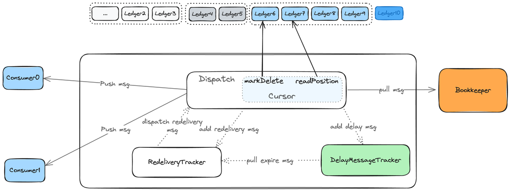
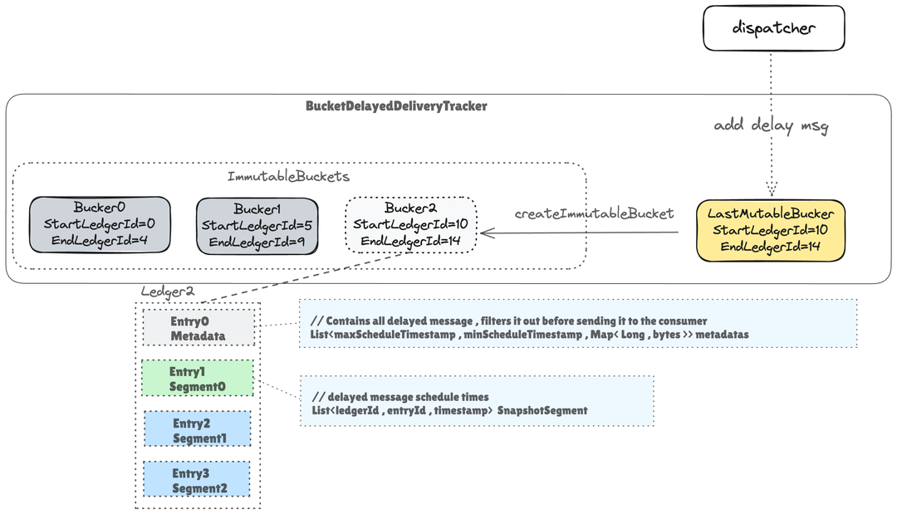
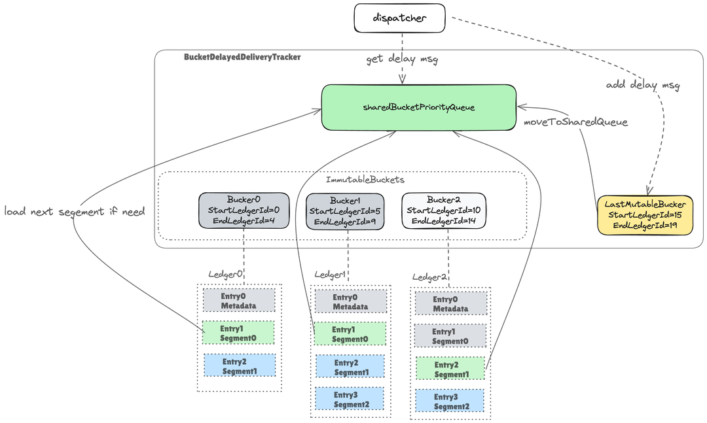

# Apache Pulsar 技术系列 - 大规模延迟消息解析

> Apache Pulsar 是一个多租户、高性能的服务间消息传输解决方案，支持多租户、低延时、读写分离、跨地域复制（GEO replication）、快速扩容、灵活容错等特性。在很多场景下，用户需要使用到延迟消息，本文是 Pulsar 技术系列中的一篇，主要介绍 Pulsar 3.x 大规模延迟消息投递的实现。

## 目录

- [1. 背景](#1-背景)
- [2. 大规模延迟消息方案](#2-大规模延迟消息方案)
  - [2.1 Pulsar 消费流程](#21-pulsar-消费流程)
  - [2.2 DelayedDeliveryTracker](#22-delayeddeliverytracker)
- [3. BucketDelayedDeliveryTracker](#3-bucketdelayeddeliverytracker)
  - [3.1 如何存储](#31-如何存储)
  - [3.2 如何读取](#32-如何读取)
  - [3.3 何时删除](#33-何时删除)
  - [3.4 bucket 数据丢失](#34-bucket-数据丢失)
  - [3.5 重建 bucket](#35-重建-bucket)
- [4. 总结](#4-总结)
- [5. 未来规划](#5-未来规划)

## 1. 背景

之前系列文章已经系统介绍了延迟消息的使用场景、使用方式以及实现原理，同时也提出了当时版本的局限性：完全基于内存构建延迟消息索引，导致无法支持大规模延迟消息场景。Pulsar 在 3.x 版本支持了基于磁盘的延迟消息索引方案，使得内存不再是延迟消息规模的瓶颈。

## 2. 大规模延迟消息方案

### 2.1 Pulsar 消费流程

在讲解延迟消息之前，先简单描述一下 Pulsar 服务端消费处理流程。Broker 为每个订阅维护单独的 Dispatcher 对象，Dispatcher 负责管理整个订阅的消费。大致流程如下：



1. Dispatcher 启动后初始化 markDelete（已 ack 最小位置）和 readPosition（当前读位置）（起始时 readPosition 为 markDelete 的下一个位置）；
2. 如果 redeliveryTracker 中有数据，优先推送 redeliveryTracker 中数据，否则从 Bookie 中读取数据；
3. 普通数据：推送数据给合适的 consumer，consumer 未就绪时，拉取到的数据把索引信息存储到 redeliveryTracker 中；
4. 延迟消息：如果时间到了，直接推送给用户，否则添加到 delayMessageTracker 里；
5. delayMessageTracker 会定时把到期数据倒入 redeliveryTracker。

可以简单理解为，Dispatcher 持续往后读取数据，已过期延迟消息就和普通消息一样推送给客户端。其余延迟消息会被添加到 DelayedDeliveryTracker，数据到期后再推送给客户端。

### 2.2 DelayedDeliveryTracker

延迟消息是由 DelayedDeliveryTracker 管理，从上图中可以看到，DelayedDeliveryTracker 主要功能为添加消息以及读取已经到期的消息，代码片段如下：

```java
public interface DelayedDeliveryTracker extends AutoCloseable {
  // 添加消息
  boolean addMessage(long ledgerId, long entryId, long deliveryAt);
  // 获取到期消息
  NavigableSet<PositionImpl> getScheduledMessages(int maxMessages);

  // 其余为辅助方法
  boolean hasMessageAvailable();
  long getNumberOfDelayedMessages();
  long getBufferMemoryUsage();
  boolean shouldPauseAllDeliveries();
  void resetTickTime(long tickTime);
  CompletableFuture<Void> clear();
  void close();
}
```

可以看到，DeliveryTracker 只添加 position 信息，data 信息是不需要保存的。目前具体的实现 Tracker 有两个：`InMemoryDelayedDeliveryTracker` 和 `BucketDelayedDeliveryTracker`，前者为完全基于内存的老版本实现，后者为基于 BK 存储支持超大规模延迟消息的实现。下文主要分析 `BucketDelayedDeliveryTracker` 的实现原理。

## 3. BucketDelayedDeliveryTracker

### 3.1 如何存储

Broker 设计为无状态服务，所以基于磁盘的 DelayedDeliveryTracker 是由 Bookie 来负责。`BucketDelayedDeliveryTracker` 为了降低磁盘的写入次数（写入 Bookie），会积累到一定量延迟消息索引后再触发写入。

可以看到 Bucket 生命周期和 Ledger 是很类似的，只有最后一个 bucket 支持写入（`LastMutableBucket`），前面的 bucket 只支持读取（`ImmutableBuckets`），读取完成后会删除。由于 Ledger 是递增的，所以可以看到每个 bucket 中 ledger 也是递增的，每个 bucket 负责存储一定范围的 ledger 延迟消息。



数据加入 DeliveryTracker 具体流程如下：

1. 判断是否存在，如果存在了，直接返回（Bucket 内的 metadata 有 bitmap 快速标识哪些 entry 是已存在的）；
2. 如果需要加入的消息 ledgerId 不包含于 `LastMutableBucket` 中的话，说明之前的数据没有存储到（不应该出现），直接放到 share 池子里面；
3. 其余正常情况会直接存储在 `LastMutableBucket` 中，`LastMutableBucket` 中的延迟消息累计到一定数量后会生成新的 `ImmutableBucket` 并刷入磁盘；
4. 刷盘成功后，会清空 `LastMutableBucket` 数据重新接收新的延迟消息写入。

当 `LastMutableBucket` 累计到一定量的延迟消息后（默认 5w，会存储完最后一个 ledger 的全部延迟消息再切换），会触发刷盘，具体步骤如下：

1. `LastMutableBucket` 内存中的延迟消息，按照时间（5min）、条数（5000）维度分成多个 segment（简单理解第一个 segment 是最新 5 分钟的消息，第二个是最近 5~10 分钟消息）；
2. 生成好每个 segment 的元数据（包含每个 segment 中消息的最大和最小时间，以及用来快速判断某个消息是否是延迟消息的 bitmap）；
3. 创建一个新的 ledger，并把元数据存储在对应 cursor property 中，格式为 `<#pulsar.internal.delayed.bucket-${startLedgerId}-${endLedgerId}, ${bucketLedgerId}>`；
4. 将元数据写入 entry0 位置，其余 segment 分别作为一个 entry 顺序写入，并关闭 ledger。

可以看到，整个 bucket 通过几次 append 写入就能把全部的延迟信息落盘，已写入的数据不能修改，只能删除。

### 3.2 如何读取

`BucketDelayedDeliveryTracker` 在 addMessage 时已经把延迟消息写入到磁盘，内存中只会存储部分的延迟消息。在 `BucketDelayedDeliveryTracker` 中内存中的延迟消息都存储在 `sharedBucketPriorityQueue`（小堆实现的优先级队列）中，所有的延迟消息都通过 `sharedBucketPriorityQueue` 来获取。

读取相对来说比较简单，大致流程如下：

1. 每次拉取延迟消息时会先把 `lastMutableBucket` 中到期的延迟消息转移到 `sharedBucketPriorityQueue` 中；
2. 在每个 `ImmutableBucket` 刷磁盘时，已经把第一个 segment 加载到 `sharedBucketPriorityQueue` 中；
3. 当 `ImmutableBucket` 中的当前 segment 中的最后一条消息被获取后，会触发从 Bookie 中加载下一个 segment 存入 `sharedBucketPriorityQueue`。



### 3.3 何时删除

`ImmutableBucket` 被使用完后，会有以下几个时机会被删除：

- Bucket 中的最后一个 segment 的最后一条数据被读取后（实现上为加载下一个 segment 发现为空时）；
- 订阅重新加载时（分区 leadership 发生变化），如果 bucket 中的延迟消息都已到期；
- bucket 触发 merge 后（可控制内存中的 bucket 个数进而控制内存消耗），会删除原先的 bucket。用户设置了 `maxNumBuckets`，已存在 bucket 个数大于这个配置值时，挑选若干个 bucket 合并成一个 bucket，并删除掉原有的 bucket；
- 用户调用 `org.apache.pulsar.client.admin.Topics#skipAllMessages`。

`ImmutableBucket` 删除时会先清空 ZK 中的元数据，再删除对应的 ledger。

### 3.4 bucket 数据丢失

如果延迟消息在 `LastMutableBucket` 中还没有刷盘到 Bookie，此时发生故障，`LastMutableBucket` 中的数据将会丢失。但是这并不会有什么影响，在重新启动后，依然会从 markDelete 位置往后读取消息，重建 bucket。这也就是为什么 Bucket 中的数据只需要被读走（不需要客户端 ack）就可以被删除。

### 3.5 重建 bucket

重建 bucket 其余与第一次构建 bucket 是一致的，都是往后读取消息，未过期的延迟消息重新加入 bucket 中，已过期的延迟消息会被当做普通消息直接推送给客户端。重建 bucket 过程资源消耗可控，也不会阻塞消费，暂时不必担心重建 bucket 对消费造成额外压力。

## 4. 总结

Pulsar 3.x 版本大规模延迟消息方案整体比较简单，采用先分桶、再分段的策略，只在内存中保存最近的延迟消息，延迟消息规模将不再受到内存的限制。新版本实际压测下来与设计基本一致，内存占用达到稳定后将不会上涨，目前验证单节点数十亿延迟消息稳定运行。

## 5. 未来规划

当前的实现版本 DelayedDeliveryTracker 是基于订阅维度，如果 Topic 下有很多订阅，占用的内存和磁盘存储会随着订阅数量等比例放大。目前这里有一定的优化空间，可以让 Topic 下的多订阅共享 DeliveryTracker 存储，类似每个订阅有单独的 readPosition 即可。
