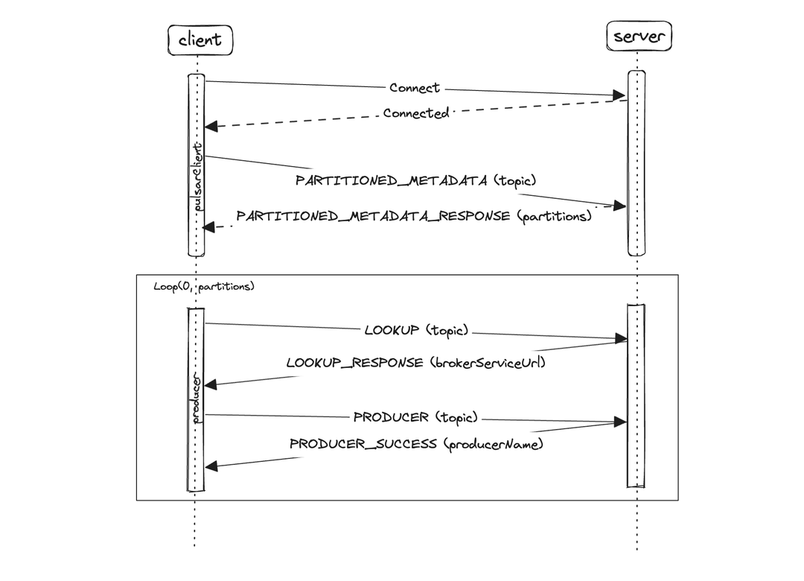
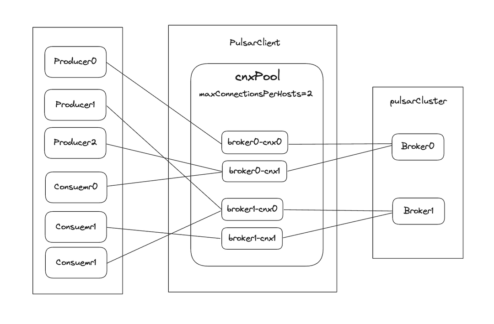
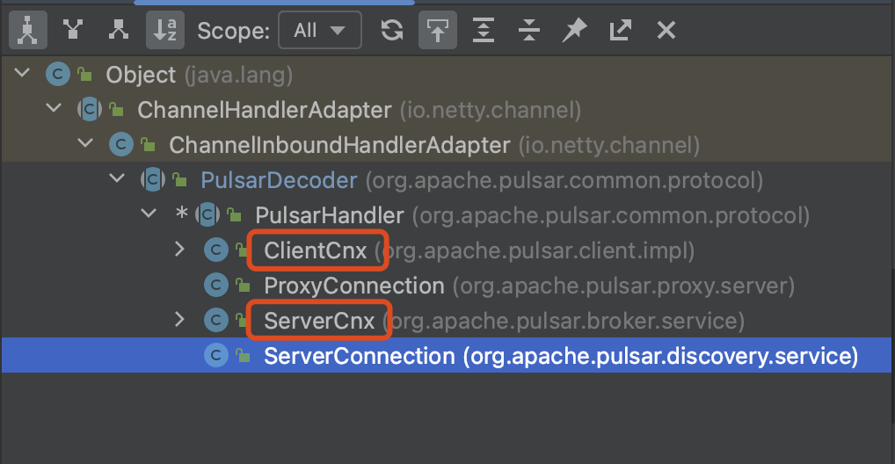
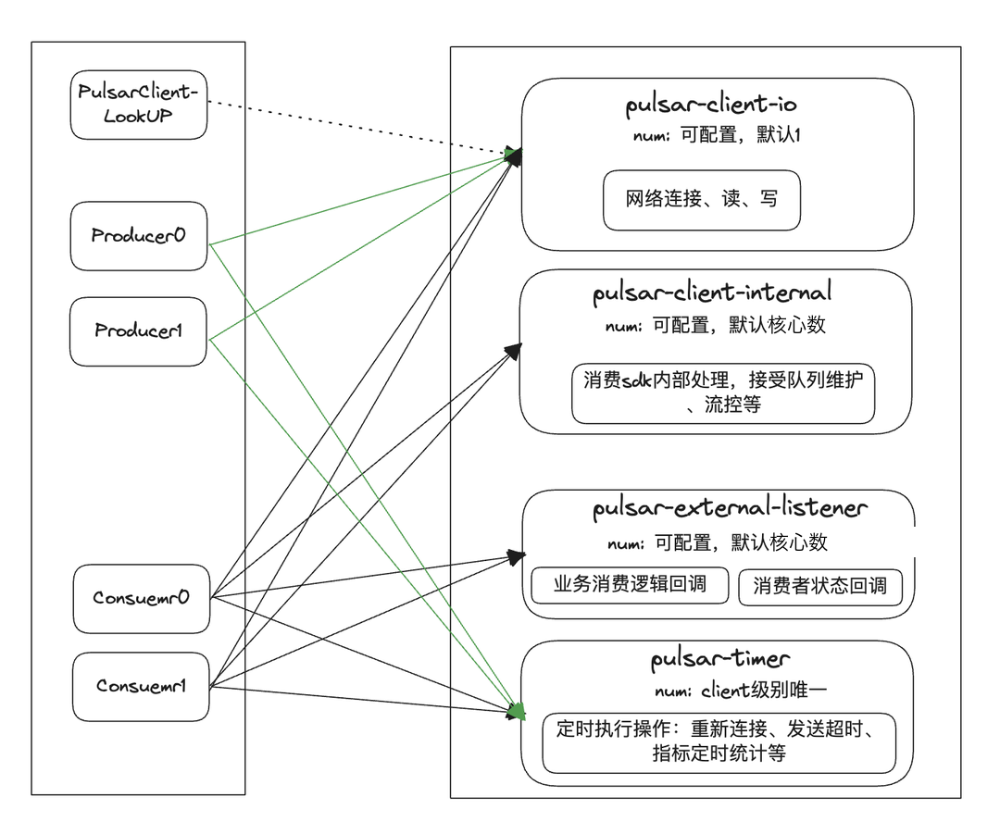

# Apache Pulsar 技术系列 - PulsarClient 实现解析

> Apache Pulsar 是一个多租户、高性能的服务间消息传输解决方案，支持多租户、低延时、读写分离、跨地域复制（GEO replication）、快速扩容、灵活容错等特性。同时为了达到高性能、低延时、高可用，Pulsar 在客户端也做了很多的优化，本文主要讲述 PulsarClient 基本原理和实现。

## 目录

- [1. PulsarClient 简介](#1-pulsarclient-简介)
- [2. PulsarClient 有哪些功能](#2-pulsarclient-有哪些功能)
- [3. 实现原理](#3-实现原理)
  - [3.1 初始化过程](#31-初始化过程)
  - [3.2 Producer 创建](#32-producer-创建)
  - [3.3 连接管理](#33-连接管理)
  - [3.4 连接健康管理](#34-连接健康管理)
  - [3.5 线程模型](#35-线程模型)
- [4. 总结和思考](#4-总结和思考)

## 1. PulsarClient 简介

Pulsar 客户端 API 设计优雅简洁，使用 PulsarClient 作为客户端的总入口，方便用户记忆和构建出具体的客户端，例如：

- **Producer**：生产者用来发送消息到指定 Topic；
- **Consumer**：消费者通过订阅关联到指定 Topic 并接收消息；
- **Reader**：手动管理 cursors 的消费者（内部使用 Consumer 实现）。

PulsarClient 还统一管理客户端系统资源，为具体的客户端提供了部分通用化处理，包括连接管理、线程管理、内存管理等。接下来让我们了解一下 PulsarClient 是如何实现的。

## 2. PulsarClient 有哪些功能

作为客户端的统一入口，下面代码片段不难看出 PulsarClient 主要功能是构建、销毁 PulsarClient 实例，以及构建各种具体 client 和事务实例。

```java
public interface PulsarClient extends Closeable {
  ProducerBuilder<byte[]> newProducer();
  <T> ProducerBuilder<T> newProducer(Schema<T> schema);
  ConsumerBuilder<byte[]> newConsumer();
  <T> ConsumerBuilder<T> newConsumer(Schema<T> schema);
  ReaderBuilder<byte[]> newReader();
  <T> ReaderBuilder<T> newReader(Schema<T> schema);
  void updateServiceUrl(String serviceUrl) throws PulsarClientException;
  CompletableFuture<List<String>> getPartitionsForTopic(String topic);
  CompletableFuture<Void> closeAsync();
  void shutdown() throws PulsarClientException;
  boolean isClosed();
  TransactionBuilder newTransaction() throws PulsarClientException;
}
```

## 3. 实现原理

### 3.1 初始化过程

PulsarClient 可以使用以下代码来实例化：

```java
PulsarClient client = PulsarClient.builder()
    .serviceUrl("pulsar://broker:6650")
    .build();
```

PulsarClient 以及具体客户端都使用 builder 模式构建，每种客户端都有对应的 ConfigurationData 来管理配置。PulsarClient 核心配置如下：

```java
public class ClientConfigurationData implements Serializable, Cloneable {
  private String serviceUrl;
  // 用来在运行时外部改变 url
  private transient ServiceUrlProvider serviceUrlProvider;
  private long operationTimeoutMs = 30000;
  private long statsIntervalSeconds = 60;
  private int numIoThreads = 1;
  private int numListenerThreads = 1;
  private int connectionsPerBroker = 1;
  private boolean useTcpNoDelay = true;
  private int concurrentLookupRequest = 5000;
  private int maxLookupRequest = 50000;
  private int maxLookupRedirects = 20;
  private int maxNumberOfRejectedRequestPerConnection = 50;
  private int keepAliveIntervalSeconds = 30;
  private int connectionTimeoutMs = 10000;
  private int requestTimeoutMs = 60000;
  private long initialBackoffIntervalNanos = TimeUnit.MILLISECONDS.toNanos(100);
  private long maxBackoffIntervalNanos = TimeUnit.SECONDS.toNanos(60);
  private boolean enableBusyWait = false;
  private String listenerName;
  // 全局内存限制(producer 使用)
  private long memoryLimitBytes = 0;
  private String proxyServiceUrl;
  private ProxyProtocol proxyProtocol;
  long tickDuration = 1;
  // transaction
  private boolean enableTransaction = false;
}
```

PulsarClient 的初始化过程比较简单，逐个初始化内部模块，以下代码片段展示了 client 内部主要的模块：

```java
public class PulsarClientImpl implements PulsarClient {
  // 配置
  protected final ClientConfigurationData conf;
  // 本地元数据管理器，主要负责 topic 分区个数、topic 对应的 owner 节点以及 schema 信息
  private LookupService lookup;
  // 共享连接池 双层 map 结构
  private final ConnectionPool cnxPool;
  // 时间轮
  private final Timer timer;
  // 执行外部逻辑线程组(主要消费使用)
  private final ExecutorProvider externalExecutorProvider;
  // 执行内部逻辑线程组(主要消费使用)
  private final ExecutorProvider internalExecutorService;
  private final AtomicReference<State> state = new AtomicReference<>();
  // producer 集合
  private final Set<ProducerBase<?>> producers;
  // consumer 集合
  private final Set<ConsumerBase<?>> consumers;
  // producer 自增 Id
  private final AtomicLong producerIdGenerator = new AtomicLong();
  // consumer 自增 Id
  private final AtomicLong consumerIdGenerator = new AtomicLong();
  // 请求自增 Id
  private final AtomicLong requestIdGenerator = new AtomicLong();
  // netty 线程组
  protected final EventLoopGroup eventLoopGroup;
  // 生产本地 buffer 内存限制器
  private final MemoryLimitController memoryLimitController;
  // ...
}
```

PulsarClient 初始化时主要创建了 Netty 客户端、连接池、时间轮等对象，只是准备好资源，并没有和服务端建立连接进行任何交互。只有在创建具体的客户端时，才会和服务端有交互。

### 3.2 Producer 创建

Pulsar 是以 topic 粒度对外提供服务，多分区 topic 等同于多个不同数字后缀的 topic 集合。下文提到的 topic-partition 包含了单分区 topic 和多分区 topic 中的一个 partition。

Pulsar 客户端的实现中 topic-partition 之间是相互独立的，SDK 内部会为每个 topic-partition 单独创建一个具体的客户端。我们在这里只介绍 Producer 的初始化流程（Consumer 类似）。

可以用以下代码构建 Producer：

```java
Producer<byte[]> producer = client.newProducer().topic("my-topic").create();
```

当 `my-topic` 为 non-partitioned topic，会实例化一个 `ProducerImpl` 对象并返回；当 `my-topic` 分区数量大于 0 时，则会创建 `PartitionedProducerImpl` 对象，`PartitionedProducerImpl` 对象内包含了 `List<ProducerImpl>`。可以理解为 PulsarClient 创建 Producer 时，最终会创建和分区数量一致的 `ProducerImpl` 对象，每个 `ProducerImpl` 都独立工作，互不影响（Consumer 类似）。

在创建 Producer 时客户端与服务端命令字交互如下：



1. PulsarClient 通过用户指定的 serviceUrl 挑选一个 url 来连接服务端，并做认证相关操作；
2. 使用 LookupService 发送 `PARTITIONED_METADATA` 命令字查询给定 Topic 的分区数；
3. 根据 Metadata 返回结果中的分区数循环创建 `ProducerImpl` 对象：
   - 3.1 `ProducerImpl` 对象初始化时会使用 LookupService 发送 `LOOKUP` 请求查询对应分区的 owner 节点；
   - 3.2 根据 `LOOKUP` 响应连接到 owner 节点，并发送 `PRODUCER` 请求向服务端创建 Producer。

到这里 Producer 就已经创建完毕，可以正式使用来发送消息了。

> 如果创建好 Producer 后，分区数量有变化了，比如服务端扩容了，客户端可以感知到并增加 `ProducerImpl` 对象数量吗？答案是可以的，默认会定时 1 分钟发起一次检测，有分区变化会做相应处理。

### 3.3 连接管理

与大部分组件一样，客户端和服务端使用长连接通信。Pulsar 协议设计上不是传统的应答模式，可以同时支持多个客户端使用同一个连接并行发送接收请求（服务端会串行处理单个 topic-partition 上的请求来保证消息顺序性）。

得益于连接共享，客户端消耗的连接数是很少的。PulsarClient 会为每台 Broker 创建一个连接池，默认连接数为 1，用户可以使用 `connectionsPerBroker` 配置来设置每台 Broker 最大连接数。`ProducerImpl`、`ConsumerImpl` 在初始化时，会随机从连接池中获取一个连接用来和服务端通信。

下图中 `maxConnectionsPerHosts=2`，连接池中为每个 Broker 创建 2 个连接，6 个客户端会在对应 topic owner 节点里随机挑选一个连接绑定。



### 3.4 连接健康管理

Pulsar keepAlive 检测是双向的，连接创建成功后，客户端和服务端都会定时 30s（`keepAliveIntervalSeconds` 配置可修改）发送 Ping 请求到对端，接收到 Ping 请求后会回应 Pong 来标识存活。在以下几种情况下，客户端、服务端都会主动断开连接：

- 超时时间内没有完成握手动作；
- 发送 Ping 或者 Pong 命令时，Netty 回调发送失败；
- 连接 `isAutoRead` 打开并且超时时间内没有收到任何请求（包含 Ping、Pong）。

连接断开后，会通知绑定在该连接上的所有客户端，这些客户端会重新从连接池中获取健康的连接。Pulsar 中空闲连接不会自动回收。

### 3.5 线程模型

PulsarClient 使用 Netty 作为网络通信框架，是标准的 Netty 客户端。协议处理和事件驱动都是依托于 Netty，核心处理类直接继承于 Netty Handler。



所以线程模型也主要围绕于 Netty 的 EventLoopGroup。上文提到，客户端资源管理都收敛于 PulsarClient，也就是使用同一个 PulsarClient 创建出来的具体客户端都共享该 PulsarClient 中的线程等资源。比如使用 clientA 对象分别创建一个或多个 Producer、Consumer、Reader 客户端，这些客户端都共享 client 中的线程资源。

PulsarClient 线程、线程组如下（图中实线表示客户端会从线程池中挑选一个线程绑定运行）：



- **pulsar-client-io**：IO 线程（Netty 内部线程），负责网络连接和读写。`numIoThreads` 参数配置，默认值为 1。客户端不直接绑定 IO 线程，而是由其内部的连接来绑定 IO 线程，所以 IO 线程数配置最好小于或者等于总连接数，否则有些线程不会使用到；
- **pulsar-client-internal**：主要用于 Consumer 内部处理，比如接收到消息后放置到接收队列等。也是通过 `numIoThreads` 参数配置，默认值为 1；
- **pulsar-external-listener**：主要用于 Consumer 外部处理，比如用户消费逻辑回调。`numListenerThreads` 参数配置，默认值为机器核心数（图中有误）；
- **pulsar-timer**：时间轮内部线程，负责所有定时操作，比如连接重连、发送超时检测等。一个 PulsarClient 对应一个线程。

简单描述一下生产消费时线程是如何交互的：

- **生产**：用户线程创建消息并放置到本地缓存，IO 线程负责把消息发送到服务端；
- **消费**：IO 线程接收到服务端的消息推送，使用 `pulsar-client-internal` 线程把消息放在本地缓存队列，然后使用 `pulsar-external-listener` 线程执行用户消息处理逻辑。

## 4. 总结和思考

本文介绍了 Pulsar 整体客户端架构，讲解了 PulsarClient、Producer 初始化过程以及客户端的连接管理和线程模型，并没有涉及到详细的生产消费过程。

大家不难发现 Pulsar 客户端和其他组件客户端相比，较大的区别就是会给每个 topic-partition 创建 producer/consumer。如果客户端关联的 topic-partition 数量很大，producer/consumer 数量会急剧膨胀，从而导致客户端需要消耗更多的资源。

也正是因为 producer/consumer 数量可能较大，连接和线程等资源不可能做到独立，只能是 producer/consumer 共享。而资源共享就不可避免出现客户端之间会相互影响，比如限流是控制在连接维度，但是由于连接是共享的，某些 Topic 的限流就会影响到该连接上的全部客户端。建议用户客户端关联的 topic-partition 数量较大时，可以适当调大连接池和线程池大小来缓解影响，或者使用不同的 PulsarClient 来做客户端隔离。
